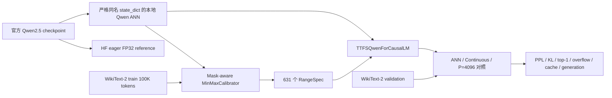
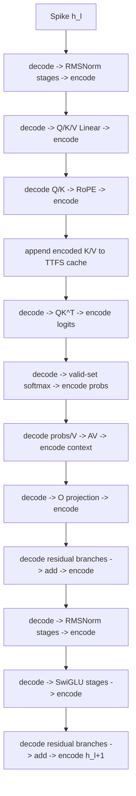
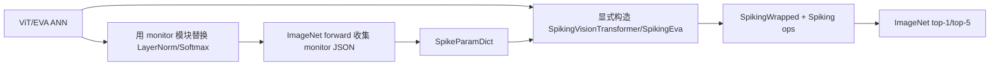
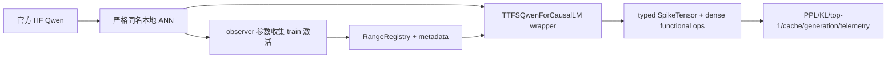

# Qwen2.5 Continuous TTFS 最小实现：逐模块方法分析

> 审计对象：commit `3cb681c190c5b82ba0d74f9e03291f4794631a5e`
> 模型：`Qwen/Qwen2.5-0.5B` Base
> 文档目的：解释当前代码做了什么、为什么 Continuous 模式近似等价、哪些部分具有研究价值，以及哪些部分仍只是功能仿真。

对应的 adversarial review 与修正路线见 [`TTFS_MVP_REVIEW_AND_REVISION.md`](TTFS_MVP_REVIEW_AND_REVISION.md)。
MVP 与跨语料实验的系统性结果总结见
[`QWEN2_5_TTFS_EXPERIMENT_RESULTS.md`](QWEN2_5_TTFS_EXPERIMENT_RESULTS.md)。

## 1. 先给结论

当前 Continuous TTFS 方法是一套 **逐语义边界的可逆时间编码功能仿真器**。它没有把 Qwen2.5 的矩阵乘、RMSNorm、Softmax 或 SwiGLU 替换成事件原生计算，而是在每个已校准边界执行：

```text
SpikeTensor(time, range_name, value_dtype)
  -> 按 RangeSpec 解码成实值
  -> 复用原 Qwen ANN 权重和 PyTorch 算子
  -> 按该节点的 RangeSpec 重新编码成 SpikeTensor
```

当 `precision=None`、所有有效激活均落在校准区间内、且不发生裁剪时，编码与解码在数学上互逆。因此，Continuous 模式首先证明的是：

1. Qwen2.5 的激活可以在 Transformer block 的主要语义边界上统一表示为单个归一化时间码；
2. 因果 mask、padding mask、RoPE、GQA、SwiGLU 和 KV cache 能在这种表示合同下保持原有语义；
3. 当前软件可以定位区间越界并量化有限时间精度造成的误差。

它尚未证明：

1. 有限精度 TTFS 能保持语言模型质量；
2. 算子能够在不恢复稠密实值的情况下事件驱动执行；
3. 系统具有延迟、能耗、存储或脉冲稀疏性收益。

这一区分是理解当前结果的核心。

## 2. 范围、术语和创新性分级

### 2.1 本文所说的 Continuous TTFS

每个激活标量 `x` 被映射为区间 `[0, 1]` 内的归一化时间码 `t`。代码中的 `t` 是与实值单调对应的稠密张量元素，不是 `(neuron_id, timestamp)` 事件列表，也没有显式物理时钟、脉冲路由或膜电位动力学。

因此，本文使用以下术语：

| 术语 | 本文含义 |
| --- | --- |
| TTFS time/code | `[0,1]` 内的归一化单脉冲时间码 |
| SpikeTensor | 保存稠密 time tensor、RangeSpec 名称和原值 dtype 的结构 |
| Continuous | 不进行时间网格量化；编码计算使用 FP64 |
| Finite `P` | 将时间量化为 `round(Pt)/P`，再裁到 `[0,1]` |
| Functional simulator | 解码、调用稠密 ANN 算子、再编码的正确性后端 |
| Event-native backend | 不依赖逐算子稠密恢复、具有明确事件执行和成本模型的后端；当前未实现 |

### 2.2 创新性分级

为避免把工程完成度误写成论文创新，本文采用三级判断：

| 等级 | 含义 |
| --- | --- |
| A：已有思想复现 | 标准 Qwen 算子、线性值域映射、min/max 校准或常规差分测试 |
| B：工程/系统贡献 | 将已有思想完整适配到因果 LLM，并建立可复现、可诊断的实现合同 |
| C：候选研究贡献 | 可能构成论文贡献，但必须经过相关工作检索、消融和系统证据验证 |

当前最稳妥的定位是 **B 级语言模型转换基线**。mask-aware TTFS attention、带区间身份的 TTFS KV cache、以及有限精度失败机制可作为 C 级候选方向，但目前证据还不足以直接宣称方法创新。
## 3. 系统总览



端到端执行顺序为：

1. 加载固定 revision 的官方 Hugging Face 模型、tokenizer 和本地 ANN；
2. 严格复制同名权重，验证官方模型和本地 ANN；
3. 用 WikiText-2 train 子集收集激活范围；
4. 生成带模型、数据、配置和 Git 元数据的 `RangeRegistry`；
5. 将本地 ANN 包装为 Continuous TTFS 模型；
6. 在完整 validation 上比较 PPL、logits、top-1 和 KL；
7. 再运行 `P=4096`、cache/no-cache 和 8-token greedy generation smoke test。

主要入口见 [`mvp.py`](../TTFS_LM/ttfs_lm/mvp.py#L271) 和 [`mvp_wikitext2.yaml`](../TTFS_LM/configs/mvp_wikitext2.yaml)。

## 4. 原始 Qwen2.5 ANN 基线

### 4.1 为什么先实现本地 ANN

直接包装 Hugging Face 内部模块会受到版本、融合 kernel 和 cache API 变化影响。当前实现先建立一个 state-dict key 与官方 `Qwen2ForCausalLM` 完全一致的本地参考模型，再在这个稳定模型上定义校准点和 TTFS 边界。

固定架构为：

| 属性 | 数值 |
| --- | ---: |
| Decoder layers | 24 |
| Hidden size | 896 |
| Intermediate size | 4864 |
| Query heads | 14 |
| KV heads | 2 |
| Head dimension | 64 |
| Vocabulary size | 151936 |
| RoPE theta | 1,000,000 |
| Norm | RMSNorm, epsilon `1e-6` |
| MLP | SwiGLU |
| Embedding / LM Head | tied weights |

加载过程见 [`checkpoint.py`](../TTFS_LM/ttfs_lm/checkpoint.py#L41)：官方模型强制使用 eager attention；本地 ANN 从官方 config 构造，随后以 `strict=True` 加载完整 state dict，并重新绑定 embedding 与 LM Head 权重。

### 4.2 ANN decoder block

对第 `l` 层，原始 ANN 数据流为：

\[
n_l = \operatorname{RMSNorm}(h_l),
\]

\[
a_l = \operatorname{Attention}(n_l), \qquad
h'_l = h_l + a_l,
\]

\[
m_l = \operatorname{SwiGLU}(\operatorname{RMSNorm}(h'_l)), \qquad
h_{l+1} = h'_l + m_l.
\]

这一实现不是新的模型结构；它的价值是给 TTFS 转换提供一个可逐节点观测、与官方权重严格对齐的数值基准。实测官方 ANN 与本地 ANN 在 262,419 个 validation 目标上的 logits 最大误差为 `0`，PPL 均为 `29.258942438`。

## 5. 校准：从 ANN 激活到 RangeSpec

### 5.1 原模块是什么

原始 Qwen 推理只传播实值张量，不需要知道每个中间张量的全局范围。对于后训练 TTFS 编码，这会产生一个额外问题：同一个 `[0,1]` 时间窗口必须知道自己对应哪个实值区间。

### 5.2 新模块是什么

[`MinMaxCalibrator`](../TTFS_LM/ttfs_lm/calibration.py#L77) 在 ANN 前向的每个语义节点接收：

```text
(range_name, value_tensor, optional_active_mask)
```

它只统计 active mask 选中的有限值，并流式维护：

```text
observed_lower, observed_upper, calls, elements
```

若观测区间为 `[m, M]`，普通节点最终使用：

\[
a = m - \gamma(M-m), \qquad
b = M + \gamma(M-m),
\]

其中当前 MVP 的 guard band `gamma=1.0`。Softmax 概率固定为 `[0,1]`；`square`、`variance` 和 `inv_rms` 的下界被约束为非负。常量张量会获得至少 `1e-6` 的非零半径。
·
### 5.3 校准数据流

MVP 只使用 WikiText-2 train split 的前 100,000 个 Qwen token：

1. 过滤空行；
2. 每个非空行独立 tokenize 并追加 EOS；
3. 将 token 流按长度 128、步长 127 打包；
4. 重叠一个 token，使每个 next-token transition 只统计一次；
5. 对 788 个序列执行完整 prefill 校准；
6. 仅对第一个 batch 额外执行逐 token decode 校准。

validation 激活不会写入 RangeSpec。数据处理见 [`data.py`](../TTFS_LM/ttfs_lm/data.py#L54)，校准循环见 [`workflow.py`](../TTFS_LM/ttfs_lm/workflow.py#L32)。

### 5.4 631 个范围如何组成

每个 decoder layer 有 26 个边界：

| 模块 | 每层范围数 | 节点 |
| --- | ---: | --- |
| 两个 RMSNorm | 10 | square、variance、inv_rms、normalized、output |
| Self-attention | 9 | q/k/v projection、q/k RoPE、logits、probs、context、o projection |
| SwiGLU MLP | 5 | gate projection、SiLU、up projection、product、down projection |
| Residual | 2 | attention residual、MLP residual |

总数为：

\[
24\times26 + 1_{embedding} + 5_{final\ norm} + 1_{lm\ head}=631.
\]

Hybrid Head 默认前向只要求其中 630 个范围；`lm_head` 在校准时被记录，但只有开启 `spike_lm_head` 才参与输出编码。

### 5.5 为什么需要它，为什么能工作

RangeSpec 把“这个 time tensor 如何还原”从隐含全局状态变成显式身份。不同语义节点即使形状相同，也不会错误共享区间。转换构造时还会检查所有必需范围是否存在，并核对 model ID 与 revision。

### 5.6 创新性与限制

- **创新性判断：B。** mask-aware、逐语义角色、可版本化 JSON 和 fail-fast 区间检查构成扎实的 LLM 转换基础设施。
- **不是新算法：** min/max 与 affine range calibration 本身是常见方法。
- **当前限制：** 只有 tensor-wise 全局范围；未区分 prefill/decode、长度桶、head/channel；decode 数据只有一个 batch；100% guard band 明显牺牲有限时间分辨率。

## 6. TTFS 表示与 Continuous 等价性

### 6.1 原模块是什么

ANN 中间状态是一个带 dtype 和 shape 的实值 tensor `x`。算子直接读取 `x`，没有额外表示元数据。

### 6.2 新模块是什么

[`SpikeTensor`](../TTFS_LM/ttfs_lm/modeling_ttfs.py#L25) 保存三个字段：

```python
SpikeTensor(
    time: Tensor,
    range_name: str,
    value_dtype: torch.dtype,
)
```

对 RangeSpec `[a,b]`，编码与解码定义为：

\[
t=E_{a,b}(x)=\frac{x-a}{b-a},
\]

\[
\hat{x}=D_{a,b}(t)=a+t(b-a).
\]

Continuous 模式令 `precision=None`，编码中间计算使用 FP64；有限精度模式为：

\[
\hat{t}=\operatorname{clip}\left(\frac{\operatorname{round}(Pt)}{P},0,1\right).
\]

### 6.3 等价性条件

在实数算术下，只要 `a < b` 且 `x in [a,b]`：

\[
D_{a,b}(E_{a,b}(x))
=a+\frac{x-a}{b-a}(b-a)
=x.
\]

因此，若一个模块被写成：

\[
S_f(t)=E_{c,d}(f(D_{a,b}(t))),
\]

那么：

\[
D_{c,d}(S_f(E_{a,b}(x)))=f(x).
\]

逐层复合后，Continuous TTFS 与 ANN 的差别只来自浮点舍入、算子调用形状差异和可能的裁剪。当前实现用 strict range 模式把裁剪变成异常而不是静默行为。

### 6.4 无效位置如何处理

mask 不编码为 TTFS。无效位置在编码时被替换成区间下界，即 time `0`，但后续算子必须继续携带布尔 sideband mask，保证这些占位值不参与校准、Softmax 或评价。

### 6.5 创新性与限制

- **创新性判断：A/B。** affine time code 是已有思想；带 `range_name` 和 dtype 的强类型表示是工程贡献。
- **关键限制：** time 增大对应 value 增大，但代码没有定义物理“越强越早”或“越强越晚”的发放方向。当前 `t` 更准确地说是归一化时间码，而不是完整神经形态发放模型。
- **关键限制：** 稠密 time tensor 与激活同形状，每个标量都有一个时间值；当前没有事件稀疏存储收益。

## 7. 逐模块转换

### 7.1 Token embedding

**ANN 原模块。** token ID 通过 `nn.Embedding` 查表：

\[
h_0=W_E[input\_ids].
\]

**TTFS 新模块。** lookup 本身保持稠密不变，其输出立即编码：

```text
input_ids -> dense embedding lookup -> encode("model.embed_tokens") -> SpikeTensor
```

**为什么这样设计。** token ID 是离散控制输入，不适合直接执行 affine time encoding。先保留 lookup 可以隔离 Transformer block 的表示正确性。

**创新性判断。** A，属于边界选择，不是脉冲 embedding。未来若宣称端到端 TTFS，必须对 embedding table 的存储、随机访问和权重共享单独设计。

### 7.2 RMSNorm

**ANN 原模块。** 对 hidden vector `x`：

\[
s=x^2,\quad v=\operatorname{mean}(s),\quad r=(v+\epsilon)^{-1/2},
\]

\[
n=xr,\quad y=w\odot n.
\]

**TTFS 新模块。** [`_rms_norm`](../TTFS_LM/ttfs_lm/modeling_ttfs.py#L212) 不把 RMSNorm 当作一个黑盒，而是在五个语义点重编码：

```text
Spike(x)
 -> decode -> square -> Spike(square)
 -> decode -> mean -> Spike(variance)
 -> decode -> rsqrt -> Spike(inv_rms)
 -> decode and multiply x -> Spike(normalized)
 -> decode and multiply weight -> Spike(output)
```

**为什么能工作。** Continuous 模式下每个边界近似可逆，计算顺序、FP32 square/mean、epsilon 和权重与 ANN 保持一致。

**技术价值。** 将误差定位到 square、variance、inv-rms、normalized 或 output，而不是只知道整个 norm 失配。

**创新性判断。** B，属于面向 Qwen RMSNorm 的细粒度转换与诊断；底层运算仍是 dense PyTorch。有限精度中，多次量化会显著放大误差，当前 `P=4096` telemetry 中 variance 是主要失控节点之一。

### 7.3 Q/K/V 投影与 GQA reshape

**ANN 原模块。** 由归一化 hidden state 计算：

\[
Q=XW_Q+b_Q,\quad K=XW_K+b_K,\quad V=XW_V+b_V.
\]

Q 有 14 个 head，K/V 各有 2 个 head。K/V 在 attention 计算前逻辑复制 7 次以匹配 query heads。

**TTFS 新模块。** `_linear` 统一执行：

```text
Spike(input) -> decode -> nn.Linear -> encode(q_proj/k_proj/v_proj)
```

reshape 和 transpose 只改变 time tensor 视图，不改变 `range_name`。GQA repeat 作用在 time tensor 上，cache 仍只存 2 个 KV heads。

**为什么能工作。** 线性权重、bias 和 reshape 顺序完全复用本地 ANN；连续编码不改变投影输出语义。

**创新性判断。** A/B。GQA 本身不是创新；避免把 cache 物化成 14-head MHA 状态是正确的语言模型系统适配。

### 7.4 RoPE

**ANN 原模块。** 对 Q/K 的成对维度应用由 position ID 决定的旋转：

\[
Q'=Q\odot\cos\theta+\operatorname{rotateHalf}(Q)\odot\sin\theta,
\]

K 同理。

**TTFS 新模块。** position ID、cos 和 sin 保持稠密 side information。Q/K 先解码，执行相同 RoPE，再分别编码为 `q_rope` 和 `k_rope`。

**为什么这样设计。** position ID 是控制状态；强行编码 position 或旋转系数不会增加当前正确性证据，反而会混淆 cache position 语义。

**创新性判断。** B 级架构适配。当前仅验证 context 128，尚不能证明长上下文 RoPE 与 cache position 稳健性。

### 7.5 因果 mask 与 valid-set Softmax

**ANN 原模块。** attention logits 为：

\[
Z=\frac{Q'K'^T}{\sqrt{d}},
\]

只允许 key position 不大于 query position，且 key 必须是有效 token。无效概率必须严格为零。

**TTFS 新模块。** 因果关系和 padding 有效性保持布尔 sideband：

\[
V_{ij}=[position_j\le position_i]\land keyValid_j.
\]

`masked_softmax` 先对无效 logits 填 `-inf`，只在有效集合上执行 softmax，随后再次将无效概率精确置零。全无效行先替换为零行，最后输出全零，避免 NaN。

TTFS 路径为：

```text
decode Q/K -> dense QK^T and scale
 -> encode(attention logits, active pair mask)
 -> decode logits -> valid-set masked softmax
 -> encode(probabilities, active pair mask)
```

**为什么能工作。** mask 从未被映射为一个有限实值，因此不会出现“被 mask 的位置因为映射到区间上界而获得大概率”的语义错误。

**创新性判断。** B，可能是 C 级候选。把因果/padding mask 明确建模为不参与 TTFS 的控制 sideband，并给出全无效行合同，是从视觉 TTFS Transformer 迁移到 decoder LLM 的关键设计。但是否具有论文新颖性仍需系统相关工作对比。

**有限精度限制。** 概率逐元素量化后不再保证和为 1。当前 AV 直接使用量化后的概率，没有重新归一化或 simplex-preserving 编码，这是有限精度误差的重要来源。

### 7.6 Attention context 与输出投影

**ANN 原模块。**

\[
C=\operatorname{Softmax}(Z)V,\qquad A=CW_O.
\]

**TTFS 新模块。** probability 和 V 解码后执行 dense AV matmul，context 编码；随后 reshape、解码、执行 `o_proj` 并再次编码。

**创新性判断。** A/B。语义边界完整且可诊断，但没有实现事件矩阵乘，也没有减少 MAC。

### 7.7 SwiGLU MLP

**ANN 原模块。**

\[
g=XW_g,\quad u=XW_u,
\]

\[
p=\operatorname{SiLU}(g)\odot u,\quad y=pW_d.
\]

**TTFS 新模块。** [`_mlp`](../TTFS_LM/ttfs_lm/modeling_ttfs.py#L291) 在 `gate_proj`、`gate_act`、`up_proj`、`product` 和 `down_proj` 五处独立编码。

**为什么能工作。** 两个分支不共享区间；乘法前恢复各自的实值语义，随后按 product 专属范围重编码。

**创新性判断。** B 级现代 LLM 算子适配。当前仍是 dense SiLU、Hadamard product 和 Linear；有限精度下 product 的长尾范围与多次 rounding 是高风险点。

### 7.8 Residual add

**ANN 原模块。** attention 和 MLP 子层分别执行：

\[
h'=h+a,\qquad h_{next}=h'+m.
\]

**TTFS 新模块。** 两个输入必须先按各自 RangeSpec 解码，实值相加后编码到 `attn_residual` 或 `mlp_residual` 的新范围。

**为什么不能直接相加 time。** 两个时间码可能对应不同 `[a,b]`；即使 time 数值相同，其实值也可能完全不同。只有在共享同一 affine 坐标系时，time 域直接加法才有意义。

**创新性判断。** A，属于表示正确性要求。后续事件后端若要避免解码，需要推导带不同 scale/offset 的时序加法或统一残差坐标系。

### 7.9 TTFS KV cache

**ANN 原模块。** 每层 cache 保存 dense K、V、position 和 valid mask，并在 decode 时沿 sequence 维追加。

**TTFS 新模块。** [`TTFSKVCacheEntry`](../TTFS_LM/ttfs_lm/modeling_ttfs.py#L113) 保存：

```text
key: SpikeTensor
value: SpikeTensor
positions: LongTensor
valid: BoolTensor
```

追加 cache 时，`_cat_spikes` 要求旧、新 K/V 的 `range_name` 和 `value_dtype` 相同。这样同一个 cache 生命周期不会混入不同 RangeSpec 身份的时间码。batch/beam reorder 只重排 batch 维，不改变时间语义。

**为什么能工作。** K/V 在进入 cache 前已经完成 RoPE 和编码；后续 attention 读取时按固定 RangeSpec 解码，position 与 valid sideband 同步追加。

**创新性判断。** B，可能是 C 级候选。带范围身份约束的 TTFS KV state 是自回归转换中特有的状态合同。但当前范围仅由字符串名称标识，没有内容 hash、phase、length bucket 或 range version；cache 也未支持 crop 和长上下文切桶。

### 7.10 Final RMSNorm 与 LM Head

**ANN 原模块。** 24 层后执行 final RMSNorm 和 tied LM Head：

\[
logits=\operatorname{RMSNorm}(h)W_E^T.
\]

**TTFS 新模块。** final RMSNorm 使用相同五边界转换。默认 Hybrid Head 将最终 SpikeTensor 解码后执行 dense vocabulary projection；只有 `spike_lm_head=True` 时才把 logits 再编码、解码一次。

**为什么采用 Hybrid Head。** 词表投影规模大，先保留 dense head 能将 block 转换正确性与大词表系统问题分离。

**创新性判断。** Hybrid Head 是实验分期策略，不是端到端 TTFS。即使打开 `spike_lm_head`，当前 Linear 仍是 dense 计算，因此也不能据此宣称 Full Head 已事件原生化。

## 8. 一个 decoder layer 的完整 Continuous 流程



这个图同时说明了当前方法的长处与短处：语义边界完整、错误可定位，但每个边界都发生稠密恢复，有限精度还会在每个边界重复量化。

## 9. 数据、PPL 与生成评测合同

### 9.1 PPL

对每个打包序列，只评价相邻两个有效 token 之间的 next-token 预测。若 `m_i` 是 attention mask：

\[
q_i=m_i\land m_{i+1},
\]

\[
NLL=-\frac{1}{\sum_i q_i}\sum_i q_i\log p(x_{i+1}\mid x_{\le i}),
\qquad PPL=e^{NLL}.
\]

步长 127 的窗口重叠使跨窗口边界的 transition 不丢失且不重复计数。比较 logits、top-1 和 KL 时使用同一 prediction mask。

### 9.2 Cache 等价

同一 prompt 分别执行：

1. 一次完整 no-cache forward；
2. 从第一个 token 开始逐 token cached forward；
3. 拼接每一步 logits 并比较所有位置。

当前官方模型 prompt 长度为 8，ANN 与 Continuous TTFS 的 cache/no-cache max-abs 均为 `1.1587e-4`，top-1 为 100%。二者误差完全相同，说明这一 prompt 上 TTFS cache 没有增加 full-vs-incremental 差异。

### 9.3 Generation

ANN 和 Continuous TTFS 使用相同 prompt、greedy argmax、8 个新 token和各自 cache。新 token agreement 为 100%。这只是一条确定性 smoke case，不代表自由生成质量已经被充分评估。

## 10. Continuous 为什么不是严格 bitwise lossless

理论可逆不等于浮点 bitwise 等价。当前最大 logits 误差 `5.8174e-5` 的来源包括：

1. FP32 value 转为 FP64 time，再经过 affine 运算后转回原 dtype；
2. 每个语义边界重复执行 affine 变换；
3. full-sequence 与 token-wise cache 计算具有不同矩阵形状和 reduction 顺序；
4. Softmax、RMSNorm 等非线性会传播前序舍入误差；
5. 若区间越界，clamp 会产生非微小误差，但 strict Continuous 当前会先抛错。

因此，适当表述是“在校准覆盖范围内近似数值等价”，而不是“任意输入上数学无损”或“bitwise lossless”。

## 11. 当前实测结果及其正确解释

| 对照 | PPL | Logits max-abs | Top-1 | Mean KL | Overflow/clip |
| --- | ---: | ---: | ---: | ---: | ---: |
| 官方 HF ANN vs 本地 ANN | 29.258942438 / 29.258942438 | 0 | 100% | 0 | N/A |
| 本地 ANN vs Continuous TTFS | 29.258942438 / 29.258942670 | `5.82e-5` | 100% | `2.28e-10` | 0 |
| 本地 ANN vs `P=4096` | 29.258942438 / `7.23e106` | 470.97 | 0.1528% | 243.35 | 1,910,180,057 clipped |

Continuous 共编码 212,335,483,786 个 active elements，没有记录到越界。`P=4096` 共编码 212,311,813,548 个 elements，约 0.8997% 被裁剪，涉及 142 个 range roles。

可支持的结论：

1. 本地 Qwen ANN 正确复刻官方 eager FP32 基线；
2. Continuous affine TTFS 表示在当前 validation 和 guard band 下保持近似等价；
3. 因果 mask 与 TTFS cache 的最小语义闭环成立；
4. 当前统一 `P=4096` 方案质量失败，并暴露严重误差传播。

不可支持的结论：

1. 有限精度 TTFS 已经可用；
2. 当前系统是事件驱动 SNN；
3. 当前实现节能、低延迟或低存储；
4. 方法已在长上下文、多领域、多语言或多模型规模上泛化；
5. 当前模块设计相对已有脉冲 Transformer 工作具有已验证的新颖性。

## 12. 模块对照与创新性总表

| 模块 | ANN 原模块 | Continuous TTFS 新路径 | 当前创新性判断 | 最大缺口 |
| --- | --- | --- | --- | --- |
| Checkpoint | HF Qwen2 | 严格同名本地 ANN + provenance | B | 仅单模型/单版本 |
| Embedding | dense lookup | lookup 后编码 | A | 非脉冲、无系统收益 |
| Calibration | 无范围合同 | mask-aware 631-role RangeRegistry | B | tensor-wise、数据窄 |
| Representation | dense value | typed SpikeTensor + affine time | A/B | 稠密 time、无事件 |
| RMSNorm | dense fused stages | 五边界 decode/compute/encode | B | 多次量化敏感 |
| QKV/GQA | dense projection | 分角色编码、2-head KV cache | B | Linear 仍 dense |
| RoPE | dense rotation | sideband position + 重编码 Q/K | B | 未验证长上下文 |
| Masked softmax | additive/boolean mask | valid-set sideband + exact zero | B/C 候选 | finite simplex 破坏 |
| Attention matmul | dense QK/AV | decode 后 dense matmul再编码 | A | 非事件原生 |
| SwiGLU | dense gate/up/product | 五边界独立范围 | B | product 长尾、量化累积 |
| Residual | value add | 各自解码后加法再编码 | A | 编码边界过多 |
| KV cache | dense K/V | range-typed time K/V + control state | B/C 候选 | 无 version/hash/length bucket |
| LM Head | tied dense projection | Hybrid dense；可选 logits 编码 | A | 非 Full TTFS |
| Evaluation | 常规 PPL | pairwise PPL + KL/top-1/telemetry | B | 数据和任务太少 |

## 13. Claim-Evidence 映射

| Claim | 直接证据 | 状态 |
| --- | --- | --- |
| 本地 ANN 与官方 Qwen2.5 eager FP32 等价 | 完整 validation logits max-abs `0` | supported |
| Continuous TTFS 在当前设置近似等价 | PPL、top-1、KL、max-abs、零越界 | supported within evaluated setting |
| mask 不会污染 Softmax | valid-set 实现和单元测试 | supported at functional level |
| TTFS cache 可用于最小生成 | cache/no-cache 与 8-token greedy smoke | supported only for one short prompt |
| `P=4096` 可保持语言质量 | PPL `7.23e106` | contradicted |
| 当前实现是事件原生 | 所有主要算子均 decode 后调用 dense PyTorch | contradicted |
| 当前实现有能效优势 | 无硬件或成本实验 | needs evidence |
| mask/cache 设计具有论文新颖性 | 尚无系统相关工作对照 | needs literature and ablation |

## 14. 方法文档自审

### 14.1 Contribution

- 已明确：当前贡献是 Qwen 因果 LLM 的完整 TTFS 功能基线，而不是有限精度成功或硬件贡献。
- 待证明：mask-aware attention 与 range-typed cache 是否超出已有脉冲 Transformer 的常规实现。

### 14.2 Writing clarity

- 关键术语 `SpikeTensor`、RangeSpec、Continuous、Finite 和 event-native 已分别定义。
- 所有模块均按原模块、新路径、等价依据、创新性和限制展开。

### 14.3 Experimental strength

- Continuous 数值证据完整，但只覆盖单模型、单数据集、短上下文。
- 有限精度结果明确失败，不能作为正向性能证据。

### 14.4 Evaluation completeness

- 当前缺少标准 test split、下游任务、长上下文、多 prompt、多 seed、多精度和量化基线。

### 14.5 Method soundness

- Continuous 表示合同在范围内成立。
- 有限精度误差、物理时间语义和事件执行合同尚未成立。

## 15. 代码索引

| 主题 | 实现 |
| --- | --- |
| 官方权重与本地 ANN | [`checkpoint.py`](../TTFS_LM/ttfs_lm/checkpoint.py) |
| Qwen ANN 算子 | [`modeling_ann.py`](../TTFS_LM/ttfs_lm/modeling_ann.py) |
| RangeSpec 与校准器 | [`calibration.py`](../TTFS_LM/ttfs_lm/calibration.py) |
| 校准循环 | [`workflow.py`](../TTFS_LM/ttfs_lm/workflow.py) |
| TTFS 表示、模块与 cache | [`modeling_ttfs.py`](../TTFS_LM/ttfs_lm/modeling_ttfs.py) |
| 转换入口 | [`conversion.py`](../TTFS_LM/ttfs_lm/conversion.py) |
| WikiText packing | [`data.py`](../TTFS_LM/ttfs_lm/data.py) |
| PPL、KL、cache 评测 | [`evaluation.py`](../TTFS_LM/ttfs_lm/evaluation.py) |
| 一键实验与产物 | [`mvp.py`](../TTFS_LM/ttfs_lm/mvp.py) |

## 16. 与原版 TTFSFormer 的代码实现和数学对比

### 16.1 对比范围

本节中的“原版 TTFSFormer”特指本仓库根目录下的视觉模型实现，而不是只依据论文文字重新描述。主要代码证据为：

| 原版主题 | 代码位置 |
| --- | --- |
| affine TTFS 编解码与范围字典 | [`ttfsformer/spike/param.py`](../ttfsformer/spike/param.py) |
| precision/noise 与 `emit()` | [`ttfsformer/spike/config.py`](../ttfsformer/spike/config.py) |
| `ann_to_snn` 与通用 wrapper | [`ttfsformer/spike/conversion.py`](../ttfsformer/spike/conversion.py) |
| LayerNorm 与 Softmax | [`ttfsformer/spike/module.py`](../ttfsformer/spike/module.py) |
| add、Hadamard 与 MatMul | [`ttfsformer/spike/ops.py`](../ttfsformer/spike/ops.py) |
| log-domain Triton MatMul | [`ttfsformer/spike/kernel/matmul.py`](../ttfsformer/spike/kernel/matmul.py) |
| ViT block 转换 | [`ttfsformer/model/spiking_vit.py`](../ttfsformer/model/spiking_vit.py) |
| MLP、SwiGLU 与 rotary helper | [`ttfsformer/model/spiking_layers.py`](../ttfsformer/model/spiking_layers.py) |
| EVA attention 与 mask 路径 | [`ttfsformer/model/spiking_eva.py`](../ttfsformer/model/spiking_eva.py) |
| 视觉 ANN 校准入口 | [`test/eval_origin.py`](../test/eval_origin.py) |
| 视觉 TTFS 评测入口 | [`test/eval_ttfs.py`](../test/eval_ttfs.py) |

原版包含两条相关视觉路径：

1. 经典 ViT：LayerNorm、全连接 MHA、GELU MLP、学习式位置 embedding 和分类头；
2. EVA 扩展：增加 rotary embedding、GLU/SwiGLU 和可选 attention mask。

因此，RoPE 和 SwiGLU 并不是 TTFS-LM 首次在整个仓库中出现。TTFS-LM 的新增点是把这些算子放入 **decoder-only 因果语言模型、GQA、padding、PPL 和跨步 KV cache** 的统一合同中。

### 16.2 两条转换流水线

原版视觉转换为：



TTFS-LM 转换为：



两者都不是对任意 PyTorch graph 的完全自动转换。原版的 `ann_to_snn()` 只负责 Linear、Conv、激活、LayerNorm 和 Softmax 等局部模块；ViT/EVA 顶层结构仍由专门的 `SpikingVisionTransformer` 或 `SpikingEva` 显式重建。TTFS-LM 也使用专门的 `TTFSQwenForCausalLM`，但不替换 ANN module tree，而是持有原 ANN 并在自己的 forward 中调用其权重模块。

### 16.3 共同的 affine TTFS 基础

两套实现使用同一个基本映射。设节点 `n` 的实值区间为：

\[
R_n=[a_n,b_n],\qquad b_n>a_n.
\]

实值到时间码的编码为：

\[
E_n(x)=\frac{x-a_n}{b_n-a_n}.
\]

时间码到实值的解码为：

\[
D_n(t)=a_n+t(b_n-a_n).
\]

对于普通 ANN 算子 `f`，两者共同的 wrapper 数学形式为：

\[
S_f(t)=E_{out}\left(f\left(D_{in}(t)\right)\right).
\]

在不量化、不裁剪的实数算术下：

\[
D_{out}\left(S_f(E_{in}(x))\right)=f(x).
\]

原版 [`SpikingWrapped`](../ttfsformer/spike/conversion.py#L9) 直接在裸 tensor 上实现这个公式；TTFS-LM [`_linear`](../TTFS_LM/ttfs_lm/modeling_ttfs.py#L203) 通过 `TTFSCodec.decode()` 和 `encode()` 实现同一模式。因此，**Linear 的 Continuous 转换思想是继承关系，不是 TTFS-LM 新提出的数学变换**。

### 16.4 时间码数据结构：裸 tensor 与强类型 SpikeTensor

| 维度 | 原版 TTFSFormer | TTFS-LM |
| --- | --- | --- |
| runtime 类型 | 普通 `torch.Tensor` | `SpikeTensor` dataclass |
| 时间语义 | 由调用点和手工传入 range 隐式决定 | `range_name` 显式绑定 RangeRegistry |
| 原 dtype | 不单独保存 | `value_dtype` 保存并在 decode 后恢复 |
| shape 变换 | 直接 reshape/transpose tensor | reshape time，同时保留 range identity |
| range 兼容性 | 依赖程序员传对 `x_range/y_range` | cache 拼接时检查 range name 与 dtype |
| provenance | JSON key 到区间 | Registry metadata 记录模型、数据、配置 |

原版函数签名通常为：

```python
ops.add(x_time, y_time, x_range, y_range, out_range, config)
```

只要调用者传错一个 range，代码仍可能运行，但解码后的实值语义已经错误。TTFS-LM 将 range identity 放入 `SpikeTensor`，降低了跨层、跨 cache 生命周期误用区间的风险。

这种改变不修改 affine 数学，却修改了软件合同：原版是“time tensor + 外部 range 参数”，TTFS-LM 是“带 range identity 的 time value object”。这是 TTFS-LM 相对原版最明确的工程增强之一。

### 16.5 Continuous 越界语义不同

原版 `SpikeConfig.emit()` 在 `precision=None` 且 `noise=None` 时直接返回输入，不执行 `[0,1]` clip。因此，即使 `x` 超过 `[a,b]`：

\[
t=E_{a,b}(x)<0\quad\text{或}\quad t>1,
\]

后续仍可通过 affine 外推恢复：

\[
D_{a,b}(E_{a,b}(x))=x.
\]

这使原版 Continuous 数值等价在数学上可扩展到区间外，但此时 `t` 已不再是合法的归一化时间窗位置。代码既不报错，也不记录越界。

TTFS-LM 的 `TTFSCodec.encode()` 先统计 `below/above`，然后始终执行 `clamp(0,1)`：

1. `strict_ranges=True`：发现 active value 越界时先抛出 `RangeViolationError`；
2. `strict_ranges=False`：记录越界量并裁剪；
3. invalid/padding value：由 sideband mask 排除，使用下界占位。

所以两者的 Continuous 合同不同：

| 合同 | 原版 | TTFS-LM |
| --- | --- | --- |
| 数值恒等优先 | 区间外仍允许 affine 外推 | 区间外 strict fail |
| 物理时间窗约束 | Continuous 时不保证 `[0,1]` | 明确要求 active time 在 `[0,1]` |
| 越界诊断 | 无 | calls/elements/below/above/max overflow |

TTFS-LM 牺牲了区间外的无条件 affine 恒等性，换取了更可审计的 TTFS 时间窗语义。

### 16.6 有限时间量化及局部误差上界

两者的 uniform time quantization 相同：

\[
Q_P(t)=\operatorname{clip}\left(\frac{\operatorname{round}(Pt)}{P},0,1\right).
\]

如果 `x in [a,b]` 且没有 clip，最近邻 rounding 满足：

\[
|Q_P(E(x))-E(x)|\le\frac{1}{2P}.
\]

解码后的单边界实值误差满足：

\[
|D(Q_P(E(x)))-x|
\le\frac{b-a}{2P}.
\]

这个式子直接解释了为什么 range width 与 precision 必须联合设计：100% guard band 将 `b-a` 扩大，会线性扩大同一 `P` 下的最坏局部重构误差。

对一条多层复合链：

\[
x_{l+1}=f_l(x_l),
\]

若第 `l` 个边界产生误差 `epsilon_l`，一阶传播近似为：

\[
\|\delta x_L\|
\lesssim
\sum_{l=0}^{L-1}
\left(\prod_{j=l+1}^{L-1}\|J_{f_j}\|\right)\epsilon_l.
\]

即使每个 `epsilon_l` 很小，深层网络中的 Jacobian 连乘也会放大早期误差。TTFS-LM 每层有 26 个语义编码边界，且语言模型有 24 层，这比只观察单模块误差更容易产生级联漂移。

### 16.7 校准器数学：平均 batch 极值与全局 active 极值

原版默认评测入口调用：

```python
set_monitor(model, lambda: MinMaxMonitor())
```

但原版 [`MinMaxMonitor`](../ttfsformer/util/monitor.py#L57) 的名称容易造成误解。设共有 `B` 个 batch，第 `i` 个 batch 的极值为 `m_i` 和 `M_i`，它最终保存的是：

\[
a_{original}=\frac{1}{B}\sum_{i=1}^{B}m_i,
\qquad
b_{original}=\frac{1}{B}\sum_{i=1}^{B}M_i.
\]

它不是：

\[
\min_i m_i,\qquad\max_i M_i.
\]

仓库虽然另有 `RangeMonitor` 实现真正的全局 min/max，但 [`eval_origin.py`](../test/eval_origin.py#L45) 默认使用的是 `MinMaxMonitor`。此外，原版 monitor：

1. 不接收 padding/causal active mask；
2. 不检查 NaN/Inf；
3. 不记录 calls/elements；
4. 不保存模型、数据和配置 provenance；
5. 默认在 ImageNet validation 上收集范围，并在同一 validation 上评测转换模型。

TTFS-LM 的校准范围为：

\[
m=\min_{x\in\mathcal{C}_{active}}x,
\qquad
M=\max_{x\in\mathcal{C}_{active}}x,
\]

\[
a_{LM}=m-\gamma(M-m),
\qquad
b_{LM}=M+\gamma(M-m).
\]

其中 padding 和无效 attention pair 不进入集合 `C_active`。train 与 validation 也在数据层分离。

这说明 TTFS-LM 的范围更保守、更可追溯，但也更宽。原版平均极值可能提高有限 `P` 的有效分辨率，却会增加未记录 clip；TTFS-LM 的 global extrema + 100% margin 降低 Continuous overflow，却显著恶化有限时间分辨率。

### 16.8 Linear/Conv wrapper：数学相同，类型合同不同

原版对 Linear、Conv、ReLU、GELU 和 SiLU 使用统一 wrapper：

\[
t_y=Q_P\left(E_y(f(D_x(t_x)))\right).
\]

TTFS-LM Linear 使用：

\[
t_y=Q_P\left(E_y(WD_x(t_x)+b)\right).
\]

Continuous 时两者都退化为 dense decode、原 ANN 运算、encode。主要差别为：

1. 原版 wrapper 支持 Conv 和视觉激活，TTFS-LM 当前只服务 Qwen 语义模块；
2. 原版 time tensor 通常保持原 tensor dtype，TTFS-LM Continuous 编码计算强制 FP64；
3. TTFS-LM 每次 encode 做 finite/overflow 检查；
4. TTFS-LM 直接复用本地 Qwen 的独立 Q/K/V projection 与 tied weights。

因此，TTFS-LM 的 Linear 不是数学创新，而是更严格的 LLM 工程实现。

### 16.9 原版 log-domain Hadamard 与 TTFS-LM direct Hadamard

原版没有直接调用 `x*y` 作为最终 product，而是使用恒等式。令：

\[
u=|x|,\qquad v=|y|,
\]

\[
m=\log(u+1)+\log(v+1).
\]

则：

\[
e^m-u-v-1
=(u+1)(v+1)-u-v-1
=uv.
\]

恢复符号后：

\[
xy=\operatorname{sign}(x)\operatorname{sign}(y)
\left(e^m-u-v-1\right).
\]

原版 [`ops.hadamard`](../ttfsformer/spike/ops.py#L50) 会对中间量 `m` 编码并调用 `emit()`，随后解码、指数恢复、施加 sign，最后再对 product 输出编码。这意味着有限精度误差不仅出现在输入/输出，也出现在 log-product 中间域。

若 `m` 的量化误差为 `delta_m`，product magnitude 的误差为：

\[
\Delta(uv)=(u+1)(v+1)(e^{\delta_m}-1),
\]

小误差下近似：

\[
|\Delta(uv)|\approx(u+1)(v+1)|\delta_m|.
\]

因此，大幅值输入会放大 log-domain 时间量化误差。

TTFS-LM 的 SwiGLU product 直接执行：

\[
p=D_g(t_g)\odot D_u(t_u),
\qquad t_p=Q_P(E_p(p)).
\]

它没有复用原版 log-domain Hadamard。这样做的优点是 Continuous 数值路径更接近 Qwen ANN，缺点是失去了原版面向时序乘法的专用结构。当前 TTFS-LM 应被称为 functional conversion，而不是原版 spiking arithmetic 在 LLM 上的完整迁移。

### 16.10 原版 log-domain MatMul 与 TTFS-LM dense MatMul

原版 [`spiking_matmul_kernel`](../ttfsformer/spike/kernel/matmul.py#L9) 把点积中的每个乘积写成以 2 为底的同类恒等式：

\[
z_{ijk}=\log_2(|A_{ik}|+1)+\log_2(|B_{kj}|+1),
\]

\[
\widetilde{p}_{ijk}
=\operatorname{sign}(A_{ik}B_{kj})
\left(2^{z_{ijk}}-|A_{ik}|-|B_{kj}|-1\right),
\]

\[
C_{ij}=\sum_k\widetilde{p}_{ijk}.
\]

在 Continuous、无 clamp 的理想算术下：

\[
\widetilde{p}_{ijk}=A_{ik}B_{kj},
\]

所以该 kernel 恢复普通矩阵乘。有限 `P` 时，原版先把 `z` 相对 `max_repr` 量化，再对 MatMul 输出执行一次 `emit()`。这构成了一个比普通 wrapper 更接近“专用时序乘法”的算子实现，尽管 kernel 仍在 dense Triton tensor 上运行，并非稀疏事件路由。

TTFS-LM attention 直接执行：

\[
Z=\operatorname{MatMul}(D_Q(t_Q),D_K(t_K)^T)/\sqrt{d},
\]

\[
t_Z=Q_P(E_Z(Z)).
\]

AV 同理。两者差异为：

| 维度 | 原版 | TTFS-LM |
| --- | --- | --- |
| product 实现 | log-domain identity + Triton | `torch.matmul` |
| Continuous fidelity | 受 log/exp/kernel FP 影响 | 更贴近原 ANN matmul |
| finite quantization | 前序边界 + product log-domain + output | 前序边界 + dense product + output |
| event-oriented structure | 较强，但仍是 dense kernel | 很弱，纯 functional |
| mask/GQA/cache | 无完整 decoder 语义 | 支持 sideband mask、GQA 和 cache |

所以 TTFS-LM 在 **LLM 语义正确性** 上前进，在 **原版专用时序算术覆盖** 上后退。未来 event backend 应重新评估原版 log-domain kernel 是否适合 QK、AV 和 SwiGLU，而不是默认 dense matmul 就是最终方案。

### 16.11 LayerNorm 与 RMSNorm 的数学差异

原版 ViT 使用 LayerNorm：

\[
\mu=\frac{1}{d}\sum_{i=1}^{d}x_i,
\qquad
\sigma^2=\frac{1}{d}\sum_{i=1}^{d}(x_i-\mu)^2,
\]

\[
y_i=\gamma_i\frac{x_i-\mu}{\sqrt{\sigma^2+\epsilon}}+\beta_i.
\]

原版 `SpikingLayerNorm` 将它分成：

1. decode 并减均值；
2. 编码 centered value；
3. decode 并计算 inverse standard deviation；
4. 编码 inverse standard deviation；
5. 通过 log-domain Hadamard 完成 normalization 和 affine scale/bias。

TTFS-LM 的 Qwen 使用 RMSNorm：

\[
v=\frac{1}{d}\sum_{i=1}^{d}x_i^2,
\qquad
r=(v+\epsilon)^{-1/2},
\]

\[
y_i=w_i x_i r.
\]

TTFS-LM 将 `square -> variance -> inv_rms -> normalized -> output` 五个节点分别编码，但乘法仍为 dense direct multiply。

二者最关键的代码级差别为：

| 项目 | 原版 LayerNorm | TTFS-LM RMSNorm |
| --- | --- | --- |
| 去均值 | 有 | 无 |
| 方差对象 | centered value | 原 value square mean |
| 乘法 | log-domain Hadamard | dense direct multiply |
| 内部 range | centered、inv_std、output | square、variance、inv_rms、normalized、output |
| mask-aware | 无 | token mask 排除 padding |

原版还有一个需要单独审计的数值问题：[`MonitoredLayerNorm`](../ttfsformer/model/monitor.py#L8) 与 `SpikingLayerNorm` 都调用 `x.var(dim)`，未显式设置 `correction=0`。在当前 PyTorch `2.11` 中，默认 `correction=1`：

\[
s^2=\frac{1}{d-1}\sum_i(x_i-\mu)^2,
\]

而 `nn.LayerNorm` 使用 population variance：

\[
\sigma^2=\frac{1}{d}\sum_i(x_i-\mu)^2.
\]

这意味着原版 monitor 替换后的“ANN”与标准 `nn.LayerNorm` 并非严格同一个公式。原版的 origin 与 TTFS 路径可能彼此一致，却不能仅据此推导“相对替换前原始 ANN 严格无损”。TTFS-LM 的 RMSNorm 明确使用 `square.mean()`，与 Qwen RMSNorm 定义一致，并通过官方 HF logits 差分验证。

此外，原版 `MonitoredLayerNorm.forward()` 的 `monitor_o` 记录的是 `inv_std` 而不是最终 `out`；实际 block 外部 monitor 仍会捕获 LayerNorm 输出，但内部 monitor 命名与数据语义不完全一致。

### 16.12 Softmax：无 mask 分解与 valid-set Softmax

原版对 logits `z` 使用稳定 Softmax 分解：

\[
m=\max_i z_i,
\]

\[
\ell=\log\sum_i e^{z_i-m},
\]

\[
p_i=e^{z_i-m-\ell}.
\]

其中 `ell` 会经过一次 TTFS encode/emit/decode，最终概率 `p` 直接调用 `emit()`。由于 `p in [0,1]`，这等价于隐式使用 probability range `[0,1]`。

经典 ViT attention 没有 padding 或 causal mask，因此这一路径足够完成图像分类。EVA 扩展虽然接收 `attn_mask`，但当前代码在 time domain 中执行：

```python
attn = attn.masked_fill(~mask, 1)
```

此时 `attn` 是 score range 的时间码。time `1` 解码为 score 上界 `b_score`，而不是 `-infinity`。因此被 mask 的 key 可能获得最大 logits 和非零概率。这条路径不能直接迁移到因果语言模型。

TTFS-LM 将 mask 定义为独立布尔 sideband，并只在有效集合 `V` 上计算：

\[
p_i=
\begin{cases}
\dfrac{e^{z_i-m_V}}{\sum_{j\in V}e^{z_j-m_V}}, & i\in V,\\
0, & i\notin V,
\end{cases}
\]

\[
m_V=\max_{j\in V}z_j.
\]

这不是对原版 Softmax 的简单复用，而是针对 decoder causal/padding 语义的必要修正。代价是 TTFS-LM 当前直接调用 dense `torch.softmax`，没有保留原版 log-sum-exp 的时序分解。

有限精度下两者仍共享一个问题：逐元素量化 probability 后，通常有：

\[
\sum_i Q_P(p_i)\ne1.
\]

TTFS-LM 当前没有重新归一化；原版也没有。这个 simplex violation 是两套有限精度实现都需要修正的数学问题。

### 16.13 Attention 结构：视觉 MHA 与因果 GQA

| 阶段 | 原版 ViT/EVA | TTFS-LM Qwen |
| --- | --- | --- |
| QKV | 单个 fused QKV，多头数相同 | 独立 Q/K/V，14 query heads / 2 KV heads |
| position | learned embedding；EVA 可选 rotary | Q/K 必须使用 RoPE |
| mask | ViT 无；EVA mask 语义有缺陷 | causal + padding bool sideband |
| QK/AV | log-domain `ops.matmul` | dense `torch.matmul` 后编码 |
| Softmax | 无 mask log-sum-exp 分解 | valid-set dense Softmax |
| state | 单次整图 forward | prefill + token decode |
| cache | 无 | 每层 TTFS K/V + position + valid |
| output | classification feature | next-token logits |

原版 attention 的困难是把 QK、Softmax 和 AV 串成 TTFS 图。TTFS-LM 的新增困难是：

1. 任意 query 只能访问过去的有效 key；
2. K/V head 数与 query head 数不同；
3. decode 时 query length 为 1，而 key length 随生成增长；
4. K/V time 必须跨调用保存并保持 RangeSpec 一致；
5. position、valid 和 cache length 必须同步推进；
6. PPL 对 logits 的尺度敏感，不只关心 argmax。

因此，TTFS-LM attention 的主要增量是 **状态与控制语义**，不是更强的时序矩阵乘。

### 16.14 MLP：原版已支持 SwiGLU，但语言路径更具体

原版基础 ViT 使用：

\[
y=W_2\phi(W_1x),
\]

EVA 扩展已经提供 `SpikingSwiGLU`：

\[
g=\operatorname{SiLU}(W_gx),
\qquad u=W_ux,
\]

\[
p=g\odot u,
\qquad y=W_2p.

\]

原版 product 使用 log-domain `ops.hadamard`。TTFS-LM Qwen MLP 的代数结构与之相同，但有三点差异：

1. Qwen gate/up/down 权重直接来自官方 state dict；
2. gate、activation、up、product、down 有独立、mask-aware RangeSpec；
3. product 使用 dense direct multiplication，而不是原版 log-domain Hadamard。

所以 TTFS-LM 对 SwiGLU 的贡献是官方 Qwen 适配、范围隔离和语言评测闭环，不应写成“首次提出 spiking SwiGLU”。

### 16.15 Residual add：数学继承与类型增强

原版和 TTFS-LM 都不能直接相加来自不同 range 的 time：

\[
t_x=E_x(x),\qquad t_y=E_y(y).
\]

正确 residual 为：

\[
t_o=E_o(D_x(t_x)+D_y(t_y)).

\]

原版 `ops.add` 由调用者显式传 `x_range`、`y_range`、`out_range`；TTFS-LM `_add` 从两个 `SpikeTensor` 的 range identity 解码，并按目标名称编码。数学相同，TTFS-LM 的增强是减少 range 误配并增加 overflow telemetry。

### 16.16 输入、位置与输出头

原版 ViT 输入路径为：

```text
image -> 外部 value_to_ttfs -> spiking patch Conv
 -> encoded cls token + dense position embedding add
 -> Transformer -> encoded classifier head output
```

原版评测直接对 encoded classifier output 做 top-1。Continuous 模式下，因为共享输出 range 且 `b>a`，affine map 单调：

\[
\operatorname*{argmax}_i E(z_i)
=\operatorname*{argmax}_i z_i.
\]

所以分类 accuracy 不要求先 decode logits。

语言模型 PPL 不只依赖排序，还依赖 logit 差值。对全局输出 range：

\[
E(z_i)=\frac{z_i-a}{b-a}.
\]

虽然常数 `-a/(b-a)` 会在 Softmax 中抵消，但 scale `1/(b-a)` 会改变温度：

\[
\operatorname{Softmax}(E(z))
=\operatorname{Softmax}\left(\frac{z}{b-a}\right)
\ne\operatorname{Softmax}(z)
\]

除非 `b-a=1`。因此，TTFS-LM 不能像原版图像分类那样直接用 encoded logits 计算 PPL。当前 Hybrid Head 输出 dense logits；可选 spiking head 也会 encode 后立即 decode，再计算语言指标。

输入侧也不同：token ID 是离散索引，TTFS-LM 先执行 dense embedding lookup 再编码。position ID 保持控制 sideband，并生成 dense RoPE cos/sin。这个选择优先保证语言语义，但没有继承原版输入 patch 和 position add 的时序算术覆盖。

### 16.17 KV cache 是原版不存在的新状态合同

原版视觉 Transformer 每次 forward 的 token 集固定，不跨调用保存 attention state。TTFS-LM 必须维护：

\[
K^{(l)}_{1:t},\qquad V^{(l)}_{1:t}
\]

并在新 token 到来时执行：

\[
K^{(l)}_{1:t+1}=\operatorname{concat}(K^{(l)}_{1:t},K^{(l)}_{t+1}),
\]

V 同理。

TTFS-LM cache 保存的是 time tensor，而不是 dense K/V：

\[
t_K=E_{R_K}(K),\qquad t_V=E_{R_V}(V).
\]

同一 cache 生命周期要求旧、新 entry 的 `range_name` 和 dtype 一致，并同步保存 position 与 valid mask。这是从原版单次视觉 forward 迁移到 autoregressive LLM 时真正新增的模块。

它仍不是最终事件 cache，因为读取时会完整 decode K/V；但它已经建立了后续研究 cache 位宽、range version、随机访问和重排所需的状态边界。

### 16.18 噪声、精度和遥测能力

| 能力 | 原版 | TTFS-LM |
| --- | --- | --- |
| Continuous | 支持 | 支持 |
| Uniform precision | 支持 | 支持 |
| Gaussian time noise | 支持 | 未实现 |
| silent finite clip | 是 | 可允许但完整计数 |
| strict overflow failure | 无 | 有 |
| per-range calls/elements | 无 | 有 |
| max under/overflow | 无 | 有 |
| NaN/Inf input check | 无 | 有 |
| active mask calibration | 无 | 有 |

原版 noise 模式为：

\[
\hat{t}=\operatorname{clip}(t+\eta,0,1),
\qquad \eta\sim\mathcal{N}(0,\sigma^2).
\]

TTFS-LM 当前只实现 Continuous 和 uniform finite precision。若要研究神经形态 jitter，应把原版 noise 机制迁移过来，但需要同时记录 clip 和 generation divergence，不能只比较一个分类 top-1。

### 16.19 仓库实测结果的对照

仓库保存了原版 ImageNet 评测 JSON。示例为：

| 模型/模式 | 指标 | 结果 |
| --- | --- | ---: |
| ViT-S monitored ANN | ImageNet top-1 | 81.406% |
| ViT-S Continuous TTFS | ImageNet top-1 | 81.406% |
| ViT-S `P=4096` | ImageNet top-1 | 81.272% |
| ViT-S `P=1024` | ImageNet top-1 | 79.880% |
| ViT-B monitored ANN | ImageNet top-1 | 85.098% |
| ViT-B Continuous TTFS | ImageNet top-1 | 85.096% |
| ViT-B `P=4096` | ImageNet top-1 | 85.124% |
| Qwen ANN | WikiText-2 MVP PPL | 29.258942438 |
| Qwen Continuous TTFS | WikiText-2 MVP PPL | 29.258942670 |
| Qwen `P=4096` | WikiText-2 MVP PPL | `7.23e106` |

视觉数值来自 [`vit_small_patch16_224`](../data/vit_small_patch16_224/) 和
[`vit_base_patch16_224`](../data/vit_base_patch16_224/) 下的 `origin-metrics.json`、
`ttfs-precise-metrics.json` 与 finite precision JSON。这里使用 “monitored ANN” 是因为
`eval_origin.py` 在计算 origin accuracy 前已经调用 `set_monitor()` 替换 LayerNorm 和 Softmax。

这些数值不能被解释为 ViT 与 Qwen 的公平性能比较，因为任务、指标、架构和校准协议不同。它们只能说明：原版有限精度在视觉分类上相对稳定，而当前语言模型方案出现了严重级联失效。

至少有六个变量可以解释这种差异：

1. **指标敏感性。** 分类 top-1 只关心最终排序；PPL 对整个词表概率分布和 logit scale 敏感；
2. **网络轨迹。** 图像分类单次 forward；语言生成还需跨 token 保存 state；
3. **校准协议。** 原版默认在 ImageNet validation 收集范围并在同一数据上评测；TTFS-LM 用 train 校准、validation 评测；
4. **范围策略。** 原版使用平均 batch extrema；TTFS-LM 使用 global extrema + 100% guard band；
5. **算子实现。** 原版 MatMul/Hadamard 有 log-domain 专用 kernel；TTFS-LM 使用 dense direct 算子但在更多语义节点量化；
6. **算子组成。** Qwen 含 RMSNorm、GQA、causal mask、大词表 Head 和深层 SwiGLU，误差路径与 ViT 不同。

所以 `P=4096` 的差距不能简单归因于“语言模型更难”。需要通过相同 range 策略、相同边界策略和 operator bypass 消融逐项验证。

### 16.20 继承、修正、新增和退化

#### 从原版直接继承

1. 逐节点校准后做 affine value-to-time mapping；
2. Continuous 与 finite precision 两种模式；
3. decode -> ANN operator -> encode 的通用 wrapper 思想；
4. Norm、Softmax、MatMul、Hadamard 和 residual 需要独立处理；
5. 权重直接继承 ANN，不从头训练 SNN。

#### TTFS-LM 修正

1. 原版无 mask Softmax 扩展为 valid-set causal/padding Softmax；
2. 范围统计改为 true streaming extrema，并排除无效位置；
3. 越界从隐式行为改为 strict failure + telemetry；
4. range 从外部裸 tuple 改为带身份的 registry；
5. 本地 ANN 先与官方 HF logits 做完整差分，避免只比较转换前后两个自定义实现。

#### TTFS-LM 新增

1. token embedding 与 next-token PPL 合同；
2. Qwen RMSNorm、独立 Q/K/V 和 GQA；
3. causal position、padding 和全无效行处理；
4. TTFS K/V cache、position/valid sideband 和 cache reorder；
5. teacher-forcing KL/top-1/logits error 与 greedy generation；
6. 数据、配置、环境和 Git provenance 工件。

#### TTFS-LM 相对原版的退化或未迁移部分

1. 未迁移 log-domain Hadamard；
2. 未迁移 Triton spiking MatMul；
3. 未迁移 Gaussian time noise；
4. Embedding、RoPE、Softmax 和 LM Head 的主要计算仍是 dense；
5. 当前有限精度质量远差于仓库中的视觉结果；
6. 尚无原版式硬件/时序算子与 LLM cache 的统一后端。

### 16.21 对“创新点”的修正结论

完成原版对比后，当前创新性应进一步收紧：

| 候选点 | 与原版关系 | 当前结论 |
| --- | --- | --- |
| affine TTFS 编解码 | 原版已有且公式相同 | 非创新 |
| decode-compute-encode wrapper | 原版 `SpikingWrapped` 已有 | 非创新 |
| LayerNorm/Softmax/Residual 分解思想 | 原版已有 | 非创新 |
| SwiGLU/RoPE | EVA 路径已有 | 不能宣称首次 |
| log-domain MatMul/Hadamard | 原版更完整 | TTFS-LM 尚未继承 |
| typed SpikeTensor/RangeRegistry | 原版用裸 tensor + tuple | 工程增强 |
| mask-aware causal Softmax | 原版 ViT 无，EVA mask 有语义缺陷 | 明确修正，候选贡献 |
| GQA + TTFS KV cache | 原版无自回归 state | 明确新增，候选贡献 |
| PPL/KL/cache/generation 评测 | 原版只做分类 accuracy | 明确新增，工程/评测贡献 |
| finite LLM 质量 | 当前失败 | 不能作为贡献 |
| event-native LLM backend | 当前不存在 | 不能作为贡献 |

因此，当前最有价值的研究问题不是“把原版公式搬到 Qwen”，而是：

1. 如何让 TTFS 表示在 causal mask 与 stateful KV cache 中保持严格语义；
2. 为什么视觉模型可接受的有限精度方案在 LLM 中发生级联失效；
3. 如何在恢复原版专用时序算术的同时，处理 GQA、RMSNorm、概率 simplex 和自回归状态；
4. 如何把 functional representation contract 推进为可测量的 event-native backend。

### 16.22 原版对比后的 Claim-Evidence 更新

| Claim | 原版代码证据 | TTFS-LM 证据 | 状态 |
| --- | --- | --- | --- |
| 两者共享同一 affine TTFS 基础 | `param.py` | `TTFSCodec` | supported |
| TTFS-LM 的 Linear 转换是新方法 | `SpikingWrapped` 已实现同一公式 | `_linear` 同构 | contradicted |
| TTFS-LM 改进了 range 类型安全 | 原版 range 由外部 tuple 传入 | `SpikeTensor.range_name` | supported |
| TTFS-LM 修正了 causal mask | EVA time=1 mask 路径不等价于 `-inf` | bool valid-set Softmax | supported at code level |
| TTFS-LM 首次支持 SwiGLU/RoPE | 原版 EVA 已有对应模块 | Qwen 路径重新适配 | contradicted as a first claim |
| TTFS-LM 新增 autoregressive TTFS state | 原版无 KV cache | TTFSCache + generation | supported for MVP scope |
| TTFS-LM 完整继承原版时序算术 | 原版有 log-domain MatMul/Hadamard | LM 使用 dense direct ops | contradicted |
| 原版有限精度结果可直接证明 LM 可行 | 视觉分类结果较稳 | LM `P=4096` 崩溃 | contradicted |

这份对比将 TTFS-LM 的准确定位从“原版 TTFSFormer 的直接语言版”调整为：**继承 affine 表示思想、修正语言控制语义、但尚未完成原版专用时序算术迁移的 Qwen functional baseline**。
