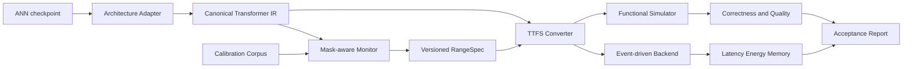

# TTFSFormer 向语言任务迁移的完整方案

> 文档版本：v1.0  
> 日期：2026-08-12  
> 状态：实施前设计评审稿

## 1. 执行摘要

本方案的目标不是把当前视觉模型外壳直接改成文本分类器，而是把 TTFSFormer 的核心能力，即逐层标定、值域到首脉冲时间的可逆映射，以及 Transformer 算子的时序实现，迁移到标准预训练语言 Transformer。最终系统暂称 **TTFS-LM**。

主研究问题是：在不从头预训练大模型的前提下，能否将已有因果语言模型转换成每个激活最多发放一个脉冲的 TTFS 模型，并同时满足以下三项要求：

1. 在连续时间或高精度仿真下保持与原模型近似等价；
2. 在有限时间精度下把语言建模质量损失控制在可接受范围；
3. 在包含词嵌入、LM Head、KV cache、存储访问和编码边界的完整核算下，仍体现可验证的系统收益。

推荐采用五级推进路线：

| 阶段 | 模型 | 目的 | 进入下一阶段的必要条件 |
| --- | --- | --- | --- |
| P0 | 两层微型 GPT | 验证因果掩码、缓存和算子契约 | 所有差分测试通过，无未来信息泄漏 |
| P1 | GPT-2 Small | 用最接近现有实现的架构完成首个因果 LM 转换 | 高精度模式 PPL 相对退化不超过 1% |
| P2 | Pythia 70M/160M/410M | 检查规模规律和校准可复现性 | 至少两个规模满足质量门槛，趋势可解释 |
| P3 | TinyLlama 1.1B | 支持 RMSNorm、RoPE、SwiGLU、GQA 和真实 KV cache | 缓存等价，有限精度结果达到预设门槛 |
| P4 | 事件驱动后端 | 验证延迟、能耗和存储收益 | 报告完整系统成本及事件原生覆盖率 |

编码器语言理解任务作为并行的低风险验证支线，建议用 BERT-base 和 GLUE 检查 padding mask、双向注意力及句级输出；核心成果仍以 decoder-only 因果语言模型为准。

本方案不预设“转换必然节能”。当前仓库的 GPU 路径会在多个算子中解码、调用普通 PyTorch/Triton 计算、再编码，它首先是数值正确性仿真器，而不是事件驱动硬件的能效证明。质量结论与硬件结论必须分别验收。

## 2. 目标、范围与成功标准

### 2.1 目标

- 支持标准 Hugging Face 因果语言模型 checkpoint 的后训练 TTFS 转换。
- 首先冻结原模型权重；只有纯转换达不到有限精度目标时，才启用区间优化或轻量校准训练。
- 支持 teacher forcing、无缓存生成和带 KV cache 生成。
- 支持连续时间、高精度离散时间和低精度离散时间三种评估模式。
- 产出可复现的校准工件、逐层误差报告、质量报告和完整系统成本报告。
- 将功能仿真后端与事件驱动后端解耦，并显式记录每个算子的后端覆盖状态。

### 2.2 非目标

- 第一阶段不从头预训练十亿参数模型。
- 不把“每个标量一个脉冲”等同于事件稀疏，也不只按 AC/MAC 数量宣称节能。
- 不在首版支持所有 Hugging Face 架构、MoE、跨注意力或投机解码。
- 不以 GPU 仿真的墙钟时间替代神经形态硬件性能。
- 不在未完成系统文献检索与对照实验前宣称“首个脉冲语言模型”或“首个 TTFS 语言模型”。

### 2.3 分层成功标准

以下数值是工程门槛，不是对实验结果的预先承诺。评审后可以调整，但实验开始后不得依据结果任意移动门槛。

| 层级 | 指标 | 目标门槛 |
| --- | --- | --- |
| 算子 | 高精度 TTFS 对 FP32 参考实现 | `atol <= 1e-5`、`rtol <= 1e-4`，特殊核单独说明误差 |
| 模块 | 注意力/MLP/Norm 输出 | 余弦相似度不低于 0.9999，无 NaN/Inf |
| 整模高精度 | 验证集 NLL/PPL | PPL 相对退化不超过 1% |
| 整模高精度 | teacher-forcing token top-1 一致率 | 不低于 99.5% |
| 有限精度 | `precision=1024` 的 PPL | 相对退化不超过 3% |
| 有限精度 | 零样本任务平均准确率 | 相对 ANN 下降不超过 1 个百分点 |
| 缓存 | cache 与 no-cache 同位置 logits | 达到对应数值模式的差分容差 |
| 鲁棒性 | 校准集外值域越界率 | 每个角色低于 `1e-5`，且无静默截断 |
| 系统 | 事件原生算子覆盖率 | 核心 block 计算量加权覆盖率不低于 80% 才讨论端到端节能 |
| 系统 | 能效 | 相同质量和生成配置下优于至少一个 FP16 及一个 INT8 基线 |

自由生成中一个很小的 logits 变化也可能改变早期 token 并造成序列分叉，因此不得把逐字符串完全一致作为唯一正确性指标。正确做法是分别报告 teacher-forcing 误差、贪心前缀存活长度、任务质量和自由生成质量。

## 3. 现有实现审计与迁移差距

### 3.1 可复用的核心

当前 TTFS 映射为：

\[
t = \frac{x-a}{b-a}, \qquad x = a + t(b-a), \qquad t\in[0,1]
\]

仓库已经提供以下可复用能力：

- `Linear`、激活函数等模块的包装和自动转换；
- 加法、标量乘法、矩阵乘法、Hadamard 乘法等时序算子；
- LayerNorm、Softmax、MLP、SwiGLU、注意力和残差路径的视觉模型实现；
- 标定监视器、有限时间精度、噪声注入和逐层转换机制。

这使迁移的重点从“重新发明 TTFS 算术”转为“补齐语言模型语义、状态和评测契约”。

### 3.2 不能直接复用的假设

| 视觉模型中的假设 | 语言模型要求 | 迁移动作 |
| --- | --- | --- |
| 固定尺寸图像和 patch embedding | token id、词嵌入和可变长度 | 新增语言输入边界和 mask-aware 校准 |
| 主要是无掩码自注意力 | 因果掩码与 padding 掩码叠加 | 重写 masked softmax 契约 |
| 单次前向分类 | 逐 token 自回归生成 | 区分 prefill 与 decode |
| 无跨步状态 | 每层 K/V cache | 定义 TTFSCache 和缓存值域版本 |
| 分类头较小 | 数万词表的 LM Head | 单独核算并分阶段脉冲化 |
| 图像位置编码 | 学习式 1D 位置或 RoPE | 增加架构适配器 |
| 校准分布相对固定 | 长度、位置、领域和生成阶段共同漂移 | 分桶、鲁棒区间和越界遥测 |
| 一次预测误差 | 误差会沿生成轨迹累积 | 增加 teacher-forcing 与 free-running 双评估 |

### 3.3 当前必须先修正的正确性问题

当前 [`spiking_eva.py`](../ttfsformer/model/spiking_eva.py) 的掩码路径把无效位置填成 TTFS 时间 `1` 后再进入 softmax。由于 `t=1` 解码为区间上界，这并不等价于在 logits 域填入负无穷，反而可能提高无效位置的概率。视觉评测没有覆盖这条路径。

语言迁移的第一个硬门槛是重新定义 masked softmax：

1. mask 是独立的布尔 sideband，不通过 TTFS 时间表示；
2. max 和 log-sum-exp 只在有效 key 上计算；
3. 无效位置的输出概率被精确置零；
4. 全无效行必须显式报错或按调用契约返回零，不允许生成 NaN；
5. 因果 mask、padding mask、左/右 padding、批量广播和 GQA 形状均有独立测试。

在该门槛通过前，不应开展整模语言质量实验。

## 4. 总体架构



系统分成五层：

1. **架构适配层**：读取 GPT-2、Pythia 或 Llama 系模型，并映射到稳定的规范化模块接口；
2. **校准层**：按张量角色、序列阶段和长度分桶收集分布，生成可追溯的 `RangeSpec`；
3. **转换层**：将规范化 block 替换为 TTFS 运算，保留权重绑定和配置语义；
4. **执行层**：功能仿真器验证数值，事件后端验证真实系统收益；
5. **评测层**：统一比较 ANN、TTFS 高精度、TTFS 有限精度及量化基线。

首版采用混合边界：token lookup 和完整 LM Head 保持值域计算，Transformer block 内部使用 TTFS。这样可以先验证最核心的序列计算。之后再分别脉冲化 embedding table 和 LM Head，避免把词表访存开销隐藏在“外围模块”中。

## 5. TTFS 表示与值域契约

### 5.1 基本契约

每个 TTFS 张量必须携带或可解析到以下元数据：

```python
@dataclass(frozen=True)
class RangeSpec:
    name: str
    lower: Tensor
    upper: Tensor
    precision: int | None
    granularity: Literal["tensor", "head", "channel", "group"]
    phase: Literal["shared", "prefill", "decode"]
    length_bucket: str
    model_hash: str
    tokenizer_hash: str
    calibration_hash: str
    version: int
```

必须满足：

- `upper - lower >= epsilon`，常量张量使用显式的零跨度处理；
- 编码前统计越界比例、最大越界量和涉及 token 位置；
- 任何 clip 都必须计数，不得静默发生；
- cache 中的时间值必须绑定 `RangeSpec` 版本，禁止不同标定版本混用；
- mask、token id、position id 和 cache 索引属于控制信息，不做 TTFS 编码。

### 5.2 两类值域模式

**保真模式**用于验证方法正确性：采用校准集观测极值加安全边界，目标是零截断。若推理遇到越界，可以扩大区间并重放，或切换到受控的浮点回退路径。它对应“经验覆盖范围内近似无损”，不能外推成任意输入的数学无损。

**效率模式**用于有限精度实验：采用分位数区间和可控截断，使大部分分辨率用于高概率区域。推荐搜索 `99.9%`、`99.99%`、`99.999%` 分位点以及不同安全边界，并由验证集 NLL 选择，而不是只按重构 MSE 选择。

现有“批次最小值/最大值再求平均”不适合作为语言模型的默认策略，因为 padding、长尾 token、位置和领域会显著改变统计。建议实现 streaming min/max、可合并分位数摘要以及 mask-aware 统计。

### 5.3 标定粒度

从简单到复杂依次启用：

1. `layer × tensor role`：P1 默认；
2. 增加 `prefill/decode`：KV cache 可用后默认；
3. 增加长度桶：`1-128`、`129-512`、`513-1024`、`1025-2048`；
4. 对 Q/K/V、门控分支和 LM Head 使用 head/channel/group 粒度；
5. 若硬件不支持细粒度缩放，回退到其可实现粒度并重新评测。

角色至少包括 residual 输入、norm 输出、Q/K/V、attention logits、attention probability、attention output、MLP 上投影、门控分支、MLP 下投影和最终 hidden state。不能让语义完全不同的张量共享一个区间。

### 5.4 时间精度

设时间窗口被划分为 `P` 个间隔，因此包含 `P+1` 个可表示时间戳：

\[
\hat{t}=\operatorname{clip}\left(\frac{\operatorname{round}(Pt)}{P},0,1\right)
\]

实验至少覆盖 `P ∈ {256, 512, 1024, 2048, 4096}` 和连续时间参考。允许逐层混合精度，但它必须是显式配置，并报告总时间级别、每层配置和估算成本。不能只报告最优层组合而省略搜索预算。

## 6. 模块级迁移设计

### 6.1 Token embedding 与位置

MVP 中 token id 先通过原始 lookup table 得到实值 embedding，再编码为 TTFS。lookup 是离散内存访问，不应强行解释为脉冲算子，其时间和能耗仍计入系统成本。

后续可将 embedding table 离线编码为 TTFS 时间表，但需要比较：

- 时间表精度带来的存储缩减或膨胀；
- tied embedding/LM Head 是否仍共享同一权重所有权；
- 词表热度缓存和随机访问成本；
- 新增 token 或 tokenizer 变更时的工件失效规则。

GPT-2 的学习式位置 embedding 按普通残差加法处理。现代模型的 RoPE 在 Q/K 投影后应用；它不是查表后简单相加，必须验证旋转前后值域、长上下文外推和 cache position 的一致性。RoPE 的标准定义见[原始论文](https://arxiv.org/abs/2104.09864)。

### 6.2 LayerNorm 与 RMSNorm

GPT-2/Pythia 首先复用并强化现有 LayerNorm 路径。RMSNorm 需要独立实现：

\[
\operatorname{RMSNorm}(x)=\frac{x}{\sqrt{\operatorname{mean}(x^2)+\epsilon}}\odot w
\]

它没有减均值步骤，不能简单把现有 LayerNorm 换名。模块应分别监测平方、均方、逆平方根和缩放后的范围，并与 Hugging Face 参考实现做差分测试。RMSNorm 的定义参考[原论文](https://arxiv.org/abs/1910.07467)。

### 6.3 因果自注意力

规范化注意力接口为：

```python
def forward(
    hidden_t,
    attention_mask: BoolTensor,
    position_ids: LongTensor,
    cache: TTFSCache | None,
    use_cache: bool,
) -> tuple[SpikeTensor, TTFSCache | None]: ...
```

计算顺序为 Q/K/V 投影、位置变换、cache 追加、QK 转置矩阵乘、缩放、masked softmax、AV 矩阵乘和输出投影。因果性由布尔 mask 约束，不把 `-inf` 编码进有限 TTFS 区间。

masked softmax 采用“有效集合上的 softmax”：

\[
p_i=\begin{cases}
\frac{\exp(z_i-m)}{\sum_{j\in V}\exp(z_j-m)}, & i\in V\\
0, & i\notin V
\end{cases}, \quad m=\max_{j\in V}z_j
\]

无效概率的零值可由零事件或显式稀疏标记表示；具体硬件语义在事件后端确定，功能仿真器先保证数值契约。测试必须覆盖单个有效 key、不同 padding 方向、批内不同长度、`q_len=1` 解码、`q_len>1` prefill，以及所有标准广播形状。

### 6.4 MLP、GELU 与 SwiGLU

GPT-2 路径采用 GELU，两次线性投影间按现有模块编码。现代路径采用：

\[
\operatorname{SwiGLU}(x)=\operatorname{SiLU}(xW_g)\odot(xW_u), \qquad y=\operatorname{SwiGLU}(x)W_d
\]

门控分支和上投影分支必须分别标定，不能因形状相同而共享区间。Hadamard 路径需覆盖负值、零值和极端门控值；若事件后端依赖对数恒等式，则对非正数的表示方式必须单独证明和测试。

### 6.5 残差、Dropout 与权重绑定

- 推理时关闭 Dropout，并校验原模型确实处于 `eval()`；
- 每个残差分支在加法前后分别有 `RangeSpec`；
- GPT-2 和 Llama 系模型的 embedding/LM Head 权重绑定必须保持对象语义或明确复制策略；
- 权重不转换成激活 TTFS 时间，权重编码和硬件存储格式作为独立设计项。

### 6.6 LM Head

LM Head 通常是 `hidden_size × vocab_size` 的大矩阵，可能主导 decode 的计算和权重访存。方案分三步：

1. **Hybrid Head**：解码最后 hidden state，使用 BF16/FP16 完整词表投影；用于证明 block 转换正确性；
2. **TTFS Full Head**：使用 TTFS 线性核完成完整投影；用于端到端覆盖率和成本核算；
3. **候选裁剪研究**：层次词表、ANN 小型候选器或 top-k 两阶段投影；只有保持相同任务质量后才计入主要结果。

任何系统收益表都必须单列 Hybrid 和 Full 两种设置，禁止把 LM Head 排除后仍称“端到端”。

### 6.7 KV cache

KV cache 是语言迁移的核心状态，而不是可选优化。推荐定义：

```python
@dataclass
class TTFSCacheEntry:
    key_time: Tensor
    value_time: Tensor
    key_range_id: str
    value_range_id: str
    seq_len: int
    position_offset: int
```

比较三种缓存方式：

| 方式 | 用途 | 优点 | 风险 |
| --- | --- | --- | --- |
| FP/BF16 K/V | 正确性基线 | 易与原模型对齐 | 无 TTFS 存储收益 |
| 离散 TTFS 时间 K/V | MVP 主方案 | 可减少位宽并保持时序语义 | 每步消费时可能需要解码 |
| 事件原生 K/V | P4 研究项 | 潜在避免密集恢复 | 硬件控制和随机访问复杂 |

prefill 与 decode 使用不同调用形状和分布，可以拥有不同计算区间，但同一 cache 生命周期内 K/V 的存储区间必须固定。若需要切换长度桶，应重编码整个 cache 或从开始就选择覆盖最大上下文的版本，不能只改变新 token 的区间。

还需支持 batch reorder、beam reorder、cache crop、position offset 和 GQA。GQA 中 K/V head 的广播应是逻辑视图，不应为了仿真便利物化为完整 MHA cache。GQA 的基本设计参考[原论文](https://arxiv.org/abs/2305.13245)。

### 6.8 编码器支线

BERT 支线复用 embedding、LayerNorm、MLP 和双向注意力，主要验证 padding mask 和句级任务。保留 `[CLS]`/pooler 或任务头的值域边界，先完成 SST-2、QQP、MNLI，再扩展完整 GLUE。BERT 架构参考[原论文](https://arxiv.org/abs/1810.04805)。该支线不能代替因果 LM 的 cache 和生成验收。

## 7. 软件工程设计

### 7.1 建议目录

```text
ttfsformer/language/
├── adapters/
│   ├── base.py
│   ├── gpt2.py
│   ├── pythia.py
│   └── llama.py
├── modules/
│   ├── attention.py
│   ├── embedding.py
│   ├── lm_head.py
│   ├── mlp.py
│   ├── norm.py
│   └── cache.py
├── backend/
│   ├── functional.py
│   └── event.py
├── calibration.py
├── conversion.py
├── generation.py
├── range_spec.py
└── telemetry.py

test/language/
├── test_masked_softmax.py
├── test_causality.py
├── test_cache_equivalence.py
├── test_module_differential.py
├── test_range_spec.py
└── test_generation.py

tools/language/
├── calibrate.py
├── compare_logits.py
├── evaluate_ppl.py
├── evaluate_tasks.py
└── benchmark_system.py

configs/language/
├── gpt2_small.yaml
├── pythia_70m.yaml
└── tinyllama_1_1b.yaml
```

### 7.2 适配原则

不建议复制并长期维护整个 Hugging Face 模型实现，也不建议依靠脆弱的全局 monkey patch。每个适配器应：

- 验证支持的 `transformers` 版本和模型配置；
- 将命名不同但语义相同的模块映射到规范化 block；
- 保存原 checkpoint 的权重绑定、位置配置、归一化 epsilon 和激活函数；
- 对未知配置 fail fast；
- 暴露 FP 参考前向和 TTFS 前向，便于逐模块比较。

建议的协议：

```python
class LanguageModelAdapter(Protocol):
    def normalize(self, model) -> CanonicalCausalLM: ...
    def calibration_points(self) -> list[TensorRole]: ...
    def convert(self, ranges: RangeRegistry, backend: Backend) -> TTFSModel: ...
    def compare_contract(self, ann_output, ttfs_output) -> Comparison: ...
```

### 7.3 工件与可追溯性

一次实验至少保存：

- 原始 checkpoint、revision 和文件哈希；
- tokenizer revision、特殊 token 和 padding side；
- 校准语料清单、去重规则、抽样 seed 和 token 哈希；
- `RangeSpec`、精度配置和转换代码 git commit；
- `transformers`、PyTorch、Triton、CUDA 和硬件版本；
- 每层误差、越界、clip、脉冲数和后端覆盖日志；
- 评测命令、原始结果和聚合脚本。

工件格式应有 schema version，加载时核对模型与 tokenizer 哈希，避免误用旧标定文件。

## 8. 校准与训练方案

### 8.1 数据构造

校准数据不需要标签，但必须代表推理分布。建议三档：

| 档位 | token 数 | 用途 |
| --- | ---: | --- |
| Smoke | 100K | 调试监视器和工件流程 |
| MVP | 5M | GPT-2/Pythia 主校准 |
| Final | 20M | 现代模型、多领域和长上下文 |

采用固定 tokenizer，按文档边界打包，明确是否插入 EOS。样本按领域和有效长度分层，不用 padding token 参与激活统计。至少保留一个同分布 holdout 和一个领域外 holdout，二者都不能用于选择区间。

推荐从模型原训练分布可获得部分、WikiText-103 及公开多领域文本中构造校准集。Pythia 提供多个规模、固定数据顺序和中间 checkpoint，适合研究转换误差随规模与训练阶段的变化，见[Pythia 论文](https://arxiv.org/abs/2304.01373)。TinyLlama 作为 1.1B 现代架构检查点，见[TinyLlama 论文](https://arxiv.org/abs/2401.02385)。具体数据使用必须记录许可证和预处理版本。

### 8.2 三阶段优化

**A. 纯后训练转换**

冻结全部权重，只收集值域并转换。这是核心方法的首要结果。先用连续时间模式定位结构错误，再搜索有限精度。

**B. 区间优化**

若有限精度不达标，固定模型权重，只优化区间边界、层级精度和安全边界。选择目标以验证集 token NLL 为主，逐层重构误差为辅。

**C. 校准感知微调**

只有 B 失败时才启用。优先使用 LoRA 或少量可训练尺度参数，损失为：

\[
\mathcal{L}=\mathcal{L}_{CE}
+\lambda_{KL}T^2\operatorname{KL}(p_{ANN}^{T}\|p_{TTFS}^{T})
+\lambda_h\sum_l \operatorname{NRMSE}(h_l^{ANN},h_l^{TTFS})
+\lambda_o\mathcal{L}_{overflow}
+\lambda_p\mathcal{L}_{precision}
\]

有限精度 round 使用直通估计器；训练和评测必须同时报告“无训练转换”与“校准感知微调”，防止把后训练转换与重新训练混为一谈。

### 8.3 校准搜索顺序

1. 全张量 min/max 加 margin；
2. 分位数区间；
3. prefill/decode 分离；
4. 长度分桶；
5. head/channel/group 粒度；
6. 逐层混合精度；
7. 区间优化；
8. 校准感知微调。

每一步只增加一种自由度，并保留上一阶段作为消融对照。

## 9. 正确性验证

### 9.1 算子测试

每个算子测试连续时间、高精度和多个离散精度，覆盖：

- 正数、负数、零、常量张量和极值；
- 非连续内存、不同 dtype、batch/head/sequence 广播；
- 区间边界内外及零跨度；
- 单 token、最大长度和非 2 的幂形状；
- CPU 参考核与 GPU 核的差分。

当前矩阵乘使用专用 Triton 路径时，高精度也未必逐位等于 PyTorch。必须同时保留一个清晰的 Torch 参考核，把“表示误差”和“实现核误差”分开。

### 9.2 必须成立的不变量

- masked probability 精确为零，有效行概率和为一；
- 修改未来 token 不改变当前位置及之前的 logits；
- 对相同有效 token，右 padding 不改变输出；左 padding 在 position id 正确时符合参考模型；
- cache 与 no-cache 在同一前缀上等价；
- 单样本与批量结果在容差内等价；
- prefill 一次计算与逐 token prefill 等价；
- GQA 的逻辑广播与物化参考等价；
- tied weight 转换前后保持；
- 所有路径无 NaN/Inf，所有截断都有遥测。

### 9.3 整模验收顺序

```text
ANN FP32
  -> ANN BF16/FP16 baseline
  -> TTFS continuous, no cache
  -> TTFS continuous, cache
  -> TTFS high precision, cache
  -> TTFS finite precision, cache
  -> TTFS event backend
```

只有前一层通过，才把后一层的偏差解释为对应因素。否则多个误差源会混在一起，无法支持结论。

## 10. 实验设计

### 10.1 模型阶梯

| 实验组 | 模型 | 核心验证点 |
| --- | --- | --- |
| E0 | 自建 2 层微型 GPT | 算子、因果性、cache、过拟合小语料 |
| E1 | GPT-2 Small 124M | LayerNorm、GELU、标准 MHA、学习位置编码 |
| E2 | Pythia 70M/160M/410M | 规模与 checkpoint 训练阶段规律 |
| E3 | TinyLlama 1.1B | RMSNorm、RoPE、SwiGLU、GQA |
| E4 | BERT-base | 双向注意力、padding mask、GLUE 支线 |

GPT-2 Small 最接近现有 EVA 中已支持的 LayerNorm、GELU 和标准注意力，故作为最低风险桥梁。Pythia 的受控模型族适合规模研究。TinyLlama 用于验证现代解码器，不应在 P1 之前直接作为首个目标。

### 10.2 数据集和任务

**语言建模**：WikiText-103 test，以及一份更广分布的固定验证子集；报告 token NLL、PPL 和按文档长度分桶的 PPL。

**零样本评测**：LAMBADA、HellaSwag、PIQA、WinoGrande、ARC-Easy、ARC-Challenge、BoolQ。统一使用 [lm-evaluation-harness](https://github.com/EleutherAI/lm-evaluation-harness)，锁定任务 revision 和 prompt 模板。

**生成评测**：固定 100 至 500 个提示，分别做 greedy 和固定 seed sampling。报告 teacher-forcing 一致性、贪心前缀存活长度、重复率、长度分布及适合数据集的任务指标。人工或模型评审只能作为补充，并需盲测。

**长上下文**：在 2048 token 内的所有不变量通过后再引入 LongBench；长上下文结果需同时报告随位置变化的越界率和 cache 成本。LongBench 参考[原论文](https://arxiv.org/abs/2308.14508)。

**编码器支线**：GLUE 中先做 SST-2、QQP、MNLI，再扩展完整任务集；报告平均值之外保留各任务分数。

### 10.3 指标

质量指标：

- token NLL、PPL、bits per byte；
- teacher-forcing top-1/top-5 一致率与 logits KL；
- 逐层 cosine、NRMSE、最大绝对误差；
- 下游准确率和相对 ANN 的百分点差；
- 自由生成的前缀分叉位置与任务指标；
- 值域越界率、clip 率和饱和位置分布。

系统指标：

- prefill tokens/s、time to first token；
- decode tokens/s、每 token p50/p95 延迟；
- batch size `1/8`，上下文长度 `128/512/1024/2048`；
- 峰值内存、权重字节、KV cache 字节/token；
- 每层脉冲数、事件数、时间窗口和同步次数；
- 事件原生计算量覆盖率；
- GPU 功耗仅作为仿真开销，事件硬件能耗另报。

### 10.4 基线

- 原始 ANN FP32 与 BF16/FP16；
- 同架构 INT8，条件允许时增加 INT4 权重量化；
- 未标定或简单全局范围的 TTFS；
- 连续时间 TTFS；
- 代表性的率编码/直接训练脉冲语言模型，只在模型、数据和任务可比时比较；
- Hybrid Head 与 Full TTFS Head；
- FP cache、TTFS cache 和事件 cache。

量化是最重要的实用基线。若 TTFS 只优于 FP16 而不优于相近质量的 INT8，则只能说明脉冲表示可行，不能说明部署方案更优。

### 10.5 主要消融

| 维度 | 设置 |
| --- | --- |
| 时间精度 | continuous / 4096 / 2048 / 1024 / 512 / 256 |
| 区间 | min-max / quantile / optimized |
| 粒度 | tensor / head / channel / group |
| 阶段 | shared / prefill-decode split |
| 长度 | shared / bucketed |
| margin | 0 / 1% / 5% / learned |
| mask | 正确 valid-set softmax / 旧填充值路径，仅作负对照 |
| cache | none / FP / TTFS / event-native |
| 边界 | hybrid embedding/head / full TTFS |
| 训练 | none / range-only / LoRA distillation |
| 精度分配 | uniform / layerwise mixed |

校准抽样和微调实验至少使用 3 个 seed，报告均值、标准差和最差值；纯确定性转换仍需用多个校准子集验证稳健性。

## 11. 完整系统成本与能耗模型

总体成本按 prefill 和 decode 分开：

\[
E_{total}=E_{compute}+E_{weight\_mem}+E_{activation\_mem}+E_{KV}
+E_{encode/decode}+E_{control}+E_{sync}
\]

必须纳入：

- embedding lookup 与位置处理；
- QKV、QK、AV、输出投影和 MLP；
- norm、softmax、残差及编码/解码；
- LM Head 完整词表投影；
- 权重、激活和 KV cache 的 SRAM/DRAM 访问；
- 事件路由、时间戳、队列和窗口同步；
- 采样器和 tokenizer 可作为主机侧成本单列。

每个标量最多一个脉冲并不自动意味着低事件密度。如果几乎所有激活都产生一个事件，收益主要来自低位宽时间表示、乘法替代和硬件数据流，而非神经元静默。报告中应同时给出：

- 每 token 可编码标量数；
- 实际事件数及零事件比例；
- 每事件携带的时间位宽；
- 事件路由与恢复实值的代价；
- 与 INT8 GEMM 的等质量、同批量比较。

TTFS 的时间窗口还可能引入层间串行延迟。端到端延迟不能仅用单层时间精度 `P` 或 AC/MAC 比例推断，必须测量或在明确的流水线硬件模型上模拟。

建议按三种证据等级报告：

| 等级 | 证据 | 可支持的表述 |
| --- | --- | --- |
| L1 | GPU 功能仿真 | 数值可行性和仿真实现开销 |
| L2 | 含内存的数据流/周期模型 | 潜在硬件收益及瓶颈 |
| L3 | FPGA/神经形态芯片测量 | 指定硬件上的实际能效和延迟 |

只有 L3 可以直接形成实测能效结论；L2 必须清楚写成估算。

## 12. 风险登记表

| 风险 | 概率/影响 | 早期信号 | 缓解措施 | 停止或转向条件 |
| --- | --- | --- | --- | --- |
| masked softmax 语义错误 | 高/致命 | padding 或未来 token 获得概率 | valid-set softmax、因果测试 | P0 未通过则停止整模实验 |
| 长度/领域导致值域漂移 | 高/高 | 越界随位置上升 | 分层校准、margin、fallback | holdout 越界持续超门槛则重设计范围 |
| 自回归误差累积 | 高/高 | teacher forcing 好但生成早分叉 | KD、层级精度、敏感层高精度 | PPL 与任务质量均失败则不扩规模 |
| LM Head 主导成本 | 高/高 | block 节能但总能耗不降 | Full Head、候选裁剪、单列成本 | 不优于 INT8 则不做端到端节能声明 |
| KV cache 区间不一致 | 中/致命 | cache/no-cache logits 不一致 | 固定 range ID、生命周期校验 | 缓存等价未通过则不做生成结论 |
| RMSNorm/RoPE/GQA 支持错误 | 中/高 | GPT-2 成功但 TinyLlama 失败 | 架构级差分测试 | P1 未通过前不进入现代架构 |
| 精度过低导致层间累积 | 高/高 | 深层误差单调放大 | mixed precision、区间优化 | `P=1024` 失败则转向高精度或训练 |
| 功能仿真与事件后端脱节 | 高/高 | 大量算子仍 decode-compute-encode | 覆盖率仪表、双后端契约 | 覆盖率低于 80% 不宣称完整 SNN |
| 一个脉冲但事件仍稠密 | 高/中 | 事件数接近标量数 | 数据流优化、零事件语义 | 实测不优于量化基线则限定贡献为表示 |
| 校准数据泄漏 | 低/高 | 只在目标测试集表现好 | 数据哈希、独立 holdout | 发现泄漏后作废对应实验 |
| 依赖版本漂移 | 中/中 | HF 输出或 cache API 改变 | 锁版本、适配器合同测试 | 不支持配置时 fail fast |

## 13. 里程碑与交付物

### M0：规格冻结与测试骨架，第 1 周

- 冻结 GPT-2 Small checkpoint、tokenizer、数据和指标；
- 完成规范化接口、`RangeSpec` schema 和测试清单；
- 交付基线 ANN 评测记录。

退出条件：同一环境可重复得到 ANN PPL 和 lm-eval 结果。

### M1：语言算子正确性，第 2 至 3 周

- 实现 valid-set masked softmax、1D mask 和因果性测试；
- 实现语言形状的 attention、MLP、LayerNorm 差分测试；
- 完成微型 GPT 的 continuous TTFS 前向。

退出条件：P0 全部不变量通过。

### M2：GPT-2 首个整模转换，第 4 至 6 周

- 完成 GPT-2 adapter、监视器和 Hybrid Head；
- 完成高精度 no-cache 与 cache 评测；
- 交付逐层误差和 PPL 报告。

退出条件：达到高精度整模质量门槛。若 PPL 相对退化超过 1%，暂停规模扩展并定位算子误差。

### M3：有限精度与校准，第 7 至 9 周

- 完成分位数、长度/阶段分桶和越界遥测；
- 完成时间精度、粒度和 margin 消融；
- 必要时实现 range-only 优化。

退出条件：`P=1024` 达到有限精度门槛，或形成有证据的最低可用精度结论。

### M4：生成与缓存，第 10 至 12 周

- 完成 TTFS cache、prefill/decode 分离和生成接口；
- 完成 greedy/sampling、batch reorder 和 cache 等价测试；
- 交付延迟、显存和 cache 字节/token 报告。

退出条件：缓存等价通过，生成质量与 teacher-forcing 误差关系可解释。

### M5：规模与现代架构，第 13 至 16 周

- 完成 Pythia 规模实验；
- 实现 RMSNorm、RoPE、SwiGLU 和 GQA；
- 完成 TinyLlama 1.1B 转换与关键消融。

退出条件：至少一个现代模型达到预定质量门槛；否则明确失败模块与规模边界。

### M6：事件后端与完整系统报告，第 17 至 20 周

- 完成核心 block 事件后端或可信周期模型；
- 实现 Full TTFS Head，核算 embedding、LM Head 与 KV cache；
- 与 BF16、INT8 做同质量比较；
- 发布复现实验配置和原始数据。

退出条件：满足覆盖率和证据等级要求。若未优于 INT8，则如实把贡献限定为 TTFS 转换可行性和误差分析。

### 13.1 资源建议

- GPT-2/Pythia 70M/160M：单张 24GB 以上 GPU 可完成大部分校准和评测；
- Pythia 410M/TinyLlama 1.1B：建议 1 至 4 张 32GB 以上 GPU，视是否微调而定；
- 校准主要是推理，优先投入存储、数据版本化和长上下文批处理；
- 事件后端应预留硬件建模或 FPGA/神经形态平台支持，不能由 GPU 结果代替。

## 14. 决策门与最终完成定义

项目只在以下门槛逐级满足时扩展：

1. **正确性门**：掩码、因果性、padding、cache 不变量全部通过；
2. **保真门**：GPT-2 高精度 PPL 相对退化不超过 1%；
3. **精度门**：有限精度达到 PPL 和下游质量门槛；
4. **规模门**：Pythia 至少两个规模呈现一致规律；
5. **现代架构门**：TinyLlama 的 RMSNorm/RoPE/GQA/cache 全部对齐；
6. **系统门**：事件原生覆盖率、完整成本和量化基线比较齐全。

最终完成定义：代码与配置可复现；校准工件可追溯；正确性、质量和系统成本均有原始结果；成功与失败设置都被报告；论文中的每个主要结论都能指向对应表格、测试或测量。

## 15. 研究定位与相关工作

TTFSFormer 本地论文 [`paper.pdf`](../paper.pdf) 提供了视觉 Transformer 的 TTFS 无损转换框架，本项目研究其在标准预训练语言 Transformer 上的适用边界。

现有脉冲语言研究提供了重要对照，但技术路线不同：

- [SpikingBERT](https://arxiv.org/abs/2308.10873) 使用平衡态平均发放率、隐式微分和 ANN-SNN 蒸馏完成 BERT 转换；
- [SpikeGPT](https://arxiv.org/abs/2302.13939) 基于 RWKV 风格结构直接训练 45M 和 216M 脉冲生成模型；
- [SpikeLLM](https://arxiv.org/abs/2407.04752) 面向 7B 至 70B LLM，重点是脉冲驱动的低位量化和稀疏加法；
- [Spike-driven Transformer](https://arxiv.org/abs/2307.01694) 主要研究视觉 Transformer 中的稀疏加法和 spike-driven attention；
- [T2FSNN](https://arxiv.org/abs/2003.11741) 是 TTFS 深层网络与 ANN-SNN 转换的重要前置工作；
- [Winner-Take-All Spiking Transformer](https://arxiv.org/abs/2604.11321) 研究直接训练的 encoder/decoder 脉冲 Transformer 和 softmax-free WTA 机制。

因此，本项目较稳妥的定位是：**研究标准预训练因果 Transformer 的单脉冲 TTFS 后训练转换、有限时间精度、KV cache 语义与完整系统成本**。这是一项需要实验证明的组合贡献，不应在文献检索尚未穷尽时宣称绝对首创。

## 16. 论断到证据映射

| 计划中的论断 | 当前依据 | 仍需获得的证据 | 可发表条件 |
| --- | --- | --- | --- |
| TTFSFormer 核心算子可复用于语言 block | 本仓库已有 Linear、MatMul、Softmax、Norm、SwiGLU | 语言形状和掩码差分测试 | P0/M1 全通过 |
| 标准预训练 LM 可高保真后训练转换 | 视觉结果及可逆映射 | GPT-2/Pythia PPL、logits、逐层误差 | 多模型满足保真门 |
| 有限时间精度仍保持任务质量 | 当前视觉精度实验 | 精度消融、下游任务、多个校准 seed | 达到预注册门槛 |
| 方法支持实际自回归生成 | 设计中的 TTFS cache | cache/no-cache 等价与自由生成结果 | M4 通过 |
| 方法适用于现代 decoder 架构 | 现有部分 SwiGLU/RoPE 代码 | TinyLlama 的 RMSNorm/GQA/cache 实验 | M5 通过 |
| TTFS-LM 具有端到端系统收益 | 理论事件计算动机 | Full Head、KV、内存、事件后端和 INT8 对比 | M6 通过；否则不作该论断 |

## 17. 预先自审与审稿人视角

### 17.1 五维自审

| 维度 | 当前评价 | 实施中必须补强的点 |
| --- | --- | --- |
| 贡献清晰度 | 问题、边界和阶段明确 | 最终摘要必须用结果而非愿景陈述贡献 |
| 写作与逻辑 | 从表示、模块到实验形成闭环 | 保持“高精度保真”和“有限精度效率”术语稳定 |
| 实验说服力 | 有模型阶梯、量化基线和消融 | 预注册门槛并报告失败设置 |
| 评测完整性 | 同时覆盖 PPL、任务、生成、系统 | 补充领域外、长上下文和置信区间 |
| 方法可靠性 | mask/cache/范围合同已明确 | 事件后端、负数乘法和 LM Head 仍是高风险实现 |

### 17.2 最可能的审稿质疑

1. **为什么不用 INT8/INT4？** 需要同质量、同批量、同上下文的实测或可信硬件模型对比。
2. **这是否只是每层 decode-compute-encode 的普通 ANN？** 需要报告事件原生覆盖率，并把功能仿真结果与事件后端结果分开。
3. **“无损”是否只在校准集成立？** 需要精确定义经验覆盖范围、越界策略和领域外结果。
4. **一个脉冲为何等于稀疏？** 不等于。必须报告实际事件数、零事件率、时间位宽和路由成本。
5. **生成分叉是否掩盖了质量下降？** 同时报告 teacher-forcing、前缀存活和任务指标，不依赖单一字符串相等。
6. **与 SpikingBERT、SpikeGPT、SpikeLLM 的区别是什么？** 用模型来源、编码方式、训练方式、注意力、cache 和规模逐项对照。
7. **校准是否偷看测试集？** 工件中保存数据哈希，设置独立同分布和领域外 holdout。
8. **LM Head 和 KV cache 是否被排除在节能统计外？** 主结果必须包含二者，Hybrid 结果只能作为模块研究。

## 18. 第一批实施任务

建议从以下可独立验收的任务开始：

1. 新增 `RangeSpec`/`RangeRegistry`，为现有 `SpikeTensor` 增加可追溯 range ID；
2. 实现 valid-set masked softmax 参考版及因果/padding 测试；
3. 建立两层微型 GPT 和 ANN/TTFS 逐模块比较工具；
4. 实现 GPT-2 adapter 与 mask-aware monitor；
5. 跑通 continuous/no-cache，再加入 finite precision；
6. 定义 TTFS cache 并验证 cache/no-cache；
7. 接入 PPL 和 lm-evaluation-harness；
8. 在质量门通过后才开始事件后端与规模扩展。

这套顺序把最可能导致整条路线失效的因果掩码、值域漂移和缓存状态放在最前面，也保证每个阶段都能形成可审查、可回退的结果。
