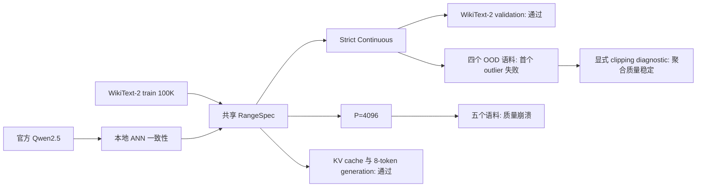

# Qwen2.5 TTFS 实验结果系统总结

> 整理日期：2026-08-30  
> 当前代码：`master@40c0820`  
> 模型：`Qwen/Qwen2.5-0.5B` Base  
> 文档目的：统一整理 MVP 与跨语料 sweep 的实验设计、结果、失败机制、证据边界和下一步任务。

相关文档：

- 方法与逐模块转换：[`CONTINUOUS_TTFS_METHOD.md`](CONTINUOUS_TTFS_METHOD.md)
- Reviewer 质疑与修正路线：[`TTFS_MVP_REVIEW_AND_REVISION.md`](TTFS_MVP_REVIEW_AND_REVISION.md)
- 数据集来源与 packing 合同：[`../TTFS_LM/DATASETS.md`](../TTFS_LM/DATASETS.md)
- 跨语料原始结果摘要：[`../TTFS_LM/DATASET_SWEEP.md`](../TTFS_LM/DATASET_SWEEP.md)

## 1. 执行摘要

当前实验支持一个清晰但有限的结论：Qwen2.5-0.5B 可以在逐语义边界的 Continuous TTFS
decode-compute-encode 表示合同下保持功能语义，但现有 range calibration 不能保证跨语料零裁剪，统一
`P=4096` 时间离散化也完全不能保持语言模型质量。

六个核心问题的答案如下：

| 研究问题 | 实验答案 | 证据状态 |
| --- | --- | --- |
| 官方 Qwen 与本地 ANN 是否一致？ | 完整 WikiText-2 validation 上 logits 最大误差为 `0` | 支持 |
| Continuous TTFS 在同分布上是否严格等价？ | PPL 几乎不变、top-1 100%、零裁剪 | 支持 |
| 同一组 ranges 能否跨语料保持 strict zero-clipping？ | WikiText-103、PTB、LAMBADA、C4 均在首个 outlier 处失败 | 否定 |
| 显式裁剪极少数 OOD outlier 后，聚合质量是否稳定？ | 四个语料相对 PPL 变化小于 `2.2e-5`，top-1 高于 99.995% | 支持，但不是严格等价 |
| `P=4096` 是否可用？ | 五个语料 PPL 均达到 `1e106` 至 `1e107`，top-1 约 0.14% 至 0.18% | 否定 |
| 当前结果能否支持事件驱动或能效结论？ | 当前计算仍是 dense PyTorch decode-compute-encode | 不支持 |

最重要的新发现不是“Continuous 已经解决 LLM 脉冲化”，而是两类失败具有完全不同的尺度：OOD
Continuous 只出现 `2` 至 `13` 个完整运行期裁剪，裁剪比例约 `1e-11` 至 `1e-10`；`P=4096` 则有约
`0.87%` 至 `0.90%` 编码元素被裁剪，并发生跨层级联失真。前者是稀有 range outlier 问题，后者是
表示分辨率、非线性敏感度和误差传播共同造成的系统性失败。

## 2. 实验故事与证据层级

### 2.1 实验故事

实验按照“参考模型正确性、连续表示正确性、跨域范围泛化、有限精度可用性、状态推理正确性”的顺序
推进。该顺序把必然成立的 affine 可逆性检查与真正困难的有限时间离散化分开，避免用 Continuous
sanity check 替代实际 TTFS 可用性证据。



### 2.2 三种结果不能混用

本文档严格区分以下三种模式：

| 模式 | 定义 | 可以证明什么 | 不能证明什么 |
| --- | --- | --- | --- |
| Strict Continuous | FP64 affine 时间编码，不允许任何越界 | 在既定 ranges 内的表示与模型语义正确性 | 有限时间精度、跨域零裁剪、系统收益 |
| Clipped Continuous diagnostic | Continuous 编码，但显式允许并记录 `[0,1]` 裁剪 | outlier 对聚合 PPL/top-1 的影响 | 严格数值等价、可忽略所有局部误差 |
| Finite `P=4096` | `round(Pt)/P` 后裁剪 | 统一有限时间网格的真实误差与失败位置 | 可用 TTFS 质量或硬件收益 |

Clipped diagnostic 不是通过 strict acceptance 的替代方案。它的作用是回答：“如果只裁剪已观测到的极少数
outlier，整体质量会下降多少？”由于其 logits 最大误差仍达到 `8.42` 至 `10.85`，它只能支持聚合质量
稳定，不能支持逐 logits 数值等价。

## 3. 实验设置

### 3.1 模型与软件环境

| 项目 | 固定值 |
| --- | --- |
| 模型 | `Qwen/Qwen2.5-0.5B` Base |
| 模型 revision | `060db6499f32faf8b98477b0a26969ef7d8b9987` |
| 模型执行 dtype | FP32 |
| Decoder layers | 24 |
| Context length | 128 |
| Batch size | 4 |
| LM Head | Hybrid dense head |
| Continuous time dtype | FP64 encode/decode 中间计算 |
| Finite precision | `P=4096` |
| GPU | NVIDIA GeForce RTX 5090 |
| CUDA / PyTorch | CUDA 13.0 / PyTorch 2.11.0+cu130 |
| Transformers / Datasets | 5.6.0 / 4.0.0 |
| Python | 3.13.11 |

官方 Hugging Face 模型使用 eager attention。本地 ANN 以严格同名 state dict 加载官方权重，并作为 TTFS
转换的稳定参考。当前 TTFS backend 在每个已定义边界解码为实值、调用 dense PyTorch 算子、再编码为
`SpikeTensor`，因此属于功能仿真器而不是 event-native backend。

### 3.2 校准设置

RangeSpec 只使用 WikiText-2 raw train 的前 100,000 个 Qwen token。校准集包含 99,999 个 next-token
目标，token SHA256 为
`9abef75c8d3d767f11485cce96acfd83c6820cdbb579447b600ad961ebdc071e`。校准采用 tensor-wise min/max、
`margin=1.0`，完整执行 prefill，并对第一个 batch 额外执行逐 token decode。

所有 OOD evaluation 数据都禁止写入 RangeSpec。这个约束保证跨语料实验测量的是共享 ranges 的泛化，而
不是按测试集重新调范围。

### 3.3 数据与评测范围

| 角色 | 语料 | 评测范围 | Qwen tokens | Prediction targets |
| --- | --- | --- | ---: | ---: |
| In-domain | WikiText-2 raw validation | 完整 split | 262,420 | 262,419 |
| OOD | WikiText-103 raw test | 完整 split | 299,241 | 299,240 |
| OOD | Penn Treebank test | 完整预处理 test 文件 | 99,256 | 99,255 |
| OOD | LAMBADA OpenAI test | 完整 default test | 396,547 | 396,546 |
| OOD | C4 English validation | 固定 shard 的前 262,420 tokens | 262,420 | 262,419 |

所有语料使用相同处理合同：过滤空 source row、逐 row tokenize、追加 EOS、按 source 顺序拼接、使用长度
128 和步长 127 打包，并只在最后一个短窗口右侧 padding。PPL、KL 与 top-1 只统计有效 next-token
位置。数据 revision、许可证、source hash 和 token hash 见
[`TTFS_LM/DATASETS.md`](../TTFS_LM/DATASETS.md)。

### 3.4 指标

| 指标 | 含义 | 方向 |
| --- | --- | --- |
| NLL / PPL | 有效 next-token 位置的平均负对数似然及其指数 | 越低越好 |
| Relative PPL change | `(PPL_candidate - PPL_ANN) / PPL_ANN` | 绝对值越小越好 |
| Top-1 agreement | ANN 与候选模型 argmax token 一致比例 | 越高越好 |
| Mean KL | ANN 与候选 logits 分布的平均 KL | 越低越好 |
| Logits max-abs | 所有有效预测位置上的最大绝对 logits 误差 | 越低越好 |
| Clipped elements / ratio | 超出 RangeSpec 后被裁剪的编码元素数及比例 | strict 模式必须为 0 |
| Violating range roles | 发生越界的语义范围类型数 | 越少越好，但不能单独代表质量 |

## 4. 实验结果

### 4.1 官方模型与本地 ANN 完全一致

官方 Hugging Face eager FP32 模型与本地 ANN 在完整 WikiText-2 validation 上逐 logits 一致。两者 PPL
均为 `29.258942438`，262,419 个预测目标上的 max-abs、mean-abs 和 mean KL 均为 `0`，top-1 agreement
为 100%。跨语料 sweep 又在 99,999 个校准目标上复核了 max-abs `0`。

这一结果建立了后续比较的可信 reference，但它不是 TTFS 方法增益。它只证明本地 Qwen 实现没有引入
权重映射或算子语义偏差。

### 4.2 In-domain Strict Continuous 通过

WikiText-2 validation 是当前唯一完整满足 strict zero-clipping 合同的正式语料结果。

| 模式 | PPL ↓ | Relative PPL change | Top-1 ↑ | Mean KL ↓ | Logits max-abs ↓ | Clips |
| --- | ---: | ---: | ---: | ---: | ---: | ---: |
| Local ANN | 29.258942438 | 0 | 100% | 0 | 0 | N/A |
| Strict Continuous | 29.258942670 | `7.91e-9` | 100% | `2.28e-10` | `5.82e-5` | 0 |

Continuous 模式在 212,335,483,786 次被统计编码中没有出现越界。该结果证明当前 affine 表示、mask、
Qwen block 和输出路径在同分布、context-128 条件下可以保持功能语义。

### 4.3 OOD Strict Continuous 4/4 失败

共享 WikiText-2 ranges 没有在任何新增语料上维持 strict zero-clipping。每个 strict run 在遇到首个越界
元素时立即停止，因此 strict 路径没有完整 OOD PPL。

| 语料 | Strict 状态 | 首个越界范围 | 方向 |
| --- | --- | --- | --- |
| WikiText-103 | range failed | `model.layers.22.input_layernorm.square` | above |
| Penn Treebank | range failed | `model.layers.22.post_attention_layernorm.square` | above |
| LAMBADA OpenAI | range failed | `model.layers.22.input_layernorm.square` | above |
| C4 English sample | range failed | `model.layers.22.input_layernorm.square` | above |

三个语料首先越过第 22 层 input RMSNorm square 上界，PTB 首先越过同层 post-attention RMSNorm square
上界。完整 clipped diagnostic 中，少量后续异常还传播到第 21 至 23 层 residual、MLP down projection 和
norm square。这说明单一全局 min/max range 对晚层异常激活缺少鲁棒性。

### 4.4 OOD Clipped Continuous 的聚合质量稳定

Strict 失败后，每个语料都使用同一 ranges 显式允许 clipping 重跑一次。该 diagnostic 完整记录 outlier，
没有把它作为 strict 通过结果。

| 语料 | ANN PPL | Diagnostic PPL | Relative change | Top-1 | Logits max-abs | Clips / encoded | Clip ratio |
| --- | ---: | ---: | ---: | ---: | ---: | ---: | ---: |
| WikiText-103 | 28.080128 | 28.080084 | `-1.55e-6` | 99.9987% | 9.83 | 4 / 242,102,407,930 | `1.65e-11` |
| Penn Treebank | 77.913091 | 77.911432 | `-2.13e-5` | 99.9960% | 10.85 | 13 / 80,302,133,450 | `1.62e-10` |
| LAMBADA OpenAI | 41.968384 | 41.968106 | `-6.63e-6` | 99.9997% | 8.42 | 11 / 320,828,158,122 | `3.43e-11` |
| C4 English sample | 29.992336 | 29.992325 | `-3.50e-7` | 99.9992% | 8.71 | 2 / 212,311,813,548 | `9.42e-12` |

四个语料的 aggregate PPL 与 top-1 都非常稳定，但这不能被表述为严格等价。原因是极少数内部 outlier
仍产生 `8.42` 至 `10.85` 的最大 logits 误差。更准确的结论是：当前 ranges 的 OOD 覆盖存在稀疏漏洞，
但在这些测试集上，显式裁剪漏洞对整体语言建模指标的影响很小。

### 4.5 `P=4096` 在 5/5 语料上完全不可用

统一 `P=4096` 时间网格在所有语料上完整执行并产生有限数值，但质量全部崩溃。

| 语料 | ANN PPL | P=4096 PPL | Top-1 | Clip ratio | Violating roles |
| --- | ---: | ---: | ---: | ---: | ---: |
| WikiText-2 validation | 29.258942 | `7.23e106` | 0.1528% | 0.8997% | 142 |
| WikiText-103 test | 28.080128 | `6.30e106` | 0.1821% | 0.8998% | 149 |
| Penn Treebank test | 77.913091 | `4.04e107` | 0.1531% | 0.9003% | 134 |
| LAMBADA OpenAI test | 41.968384 | `3.95e106` | 0.1440% | 0.8695% | 145 |
| C4 English sample | 29.992336 | `2.99e107` | 0.1589% | 0.8885% | 142 |

以 WikiText-2 为例，finite NLL 为 `246.05`、logits max-abs 为 `470.97`、mean KL 为 `243.35`。约
19.1 亿个编码元素被裁剪，覆盖 142 类 range role。跨语料的相似失败幅度说明这不是单一数据集 outlier，
而是当前统一时间精度和逐中间节点编码策略的系统性问题。

### 4.6 Cache 与最小生成闭环通过

固定提示 `Time-to-first-spike language models can` 上，ANN 与 Continuous TTFS 都完成 8 个新 token 的
greedy generation，生成 token agreement 为 100%，文本均为：

```text
Time-to-first-spike language models can be used to predict the time it takes
```

ANN 与 Continuous TTFS 的 cache/no-cache max-abs 都为 `1.1587e-4`、top-1 agreement 都为 100%、最终
cache length 都为 8。TTFS 没有在 ANN 自身的逐 token 浮点归约差异之外增加额外 cache 误差。

该结果只覆盖 batch size 1、固定短提示、greedy decoding 和 8-token decode。它不证明长上下文、动态 batch、
beam search、sampling 或 cache range 生命周期已经稳健。

## 5. 失败机制分析

### 5.1 OOD Continuous 是稀有 outlier 问题

OOD diagnostic 的裁剪比例仅为 `9.42e-12` 至 `1.62e-10`。首个失败集中在第 22 层 RMSNorm square，说明
主要矛盾是少量 hidden activation 的平方超过单一 tensor-wise 上界。由于 square 会放大绝对值 outlier，
即使原 hidden 值只出现一次异常，其 norm 中间量也会立即违反 strict range。

因此，下一步不应直接把所有 range 再扩大一个统一倍数。统一扩大虽然可能消除 strict failure，却会进一步
降低 `P=4096` 的有效值分辨率。更合理的候选方向是定位异常 token/position，分离 norm 中间量，尝试
channel/group range、稳健分位数加独立 outlier path，或仅对晚层 norm 使用更高精度。

### 5.2 `P=4096` 是跨层级联问题

Finite 模式约 `0.9%` 的裁剪比例比 OOD Continuous diagnostic 高约 8 至 9 个数量级。误差在 RMSNorm
square/variance、attention、residual 和 MLP 后段持续累积，导致后续激活分布逐渐离开由 ANN 校准得到的
ranges。此时 clipping 不再是少量输入 outlier，而是量化误差推动模型进入新的错误分布。

造成级联的候选机制包括：

1. `margin=1.0` 的宽范围降低了每个 `1/P` 时间步对应的实值分辨率；
2. 每层 26 个语义边界反复执行量化，局部舍入误差被深度累积；
3. RMSNorm square、variance 和 reciprocal square root 对误差敏感；
4. residual 与 MLP product 把不同路径误差重新组合；
5. 一旦下游范围开始裁剪，误差分布不再近似独立小噪声。

当前数据只证明这些机制与现象一致，尚未通过逐算子消融建立因果归因。正式结论必须等待 progressive
quantization、operator bypass 和逐层重建误差实验。

## 6. 当前可以与不可以声称什么

### 6.1 已有证据支持的表述

1. 本地 Qwen2.5-0.5B ANN 在固定 FP32 eager 合同下与官方模型完全一致。
2. Continuous affine TTFS 表示可以在当前功能后端中保持 Qwen block、mask、RoPE、GQA、SwiGLU 和短 KV
   cache 的语义。
3. WikiText-2 validation 上 strict Continuous 达到零裁剪和几乎不变的 PPL。
4. 单域 100K-token min/max ranges 在四个 OOD 语料上都会遇到极少数晚层 norm/residual outlier。
5. 显式裁剪这些 outlier 后，四个测试语料的 aggregate PPL/top-1 变化很小。
6. 当前统一 `P=4096` 方案在所有测试语料上失败，且失败具有跨数据集一致性。

### 6.2 当前证据不支持的表述

1. “Qwen2.5 已成功转换为可用的有限精度 TTFS/SNN 模型。”
2. “Continuous TTFS 在任意分布上严格等价或不需要 clipping。”
3. “TTFS 比 FP16、INT8 或 INT4 更准确、更快或更节能。”
4. “当前 backend 是事件驱动或神经形态硬件可直接执行的。”
5. “LAMBADA benchmark 已通过。”当前只报告整语料 PPL，不是 last-word accuracy。
6. “C4 validation 已完整评测。”当前只使用一个固定 shard 的 262,420-token 样本。
7. “长上下文和自由生成已经验证。”当前 context 为 128，生成只有一个 8-token greedy 用例。

## 7. 下一轮实验优先级

### P0：定位并处理 OOD strict outlier

1. 在 strict failure 时保存 token ID、source row、position、layer、channel 和原始 activation。
2. 对第 21 至 23 层 norm/residual 比较 tensor、channel、group 和 outlier-separated ranges。
3. 分离 prefill/decode ranges，并增加不同长度桶。
4. 只使用 calibration split 选择 range 策略，保持 validation/test 不参与范围拟合。
5. 在相同五个语料上复测 strict clip=0、PPL、top-1 和 logits tail error。

退出条件：不使用 evaluation 激活调参，五个固定语料 strict Continuous 全部零裁剪，且 PPL 相对变化不超过
0.1%。

### P1：建立 `P=4096` 误差因果图

1. 记录每层 hidden、Q/K/V、attention、norm、MLP 与 residual 的 cosine、NRMSE、max-abs 和 SNR。
2. 执行从前向后、从后向前的 progressive layer quantization。
3. 执行 operator bypass：norm、attention、MLP、residual 分别保留 Continuous。
4. 比较 every-intermediate、block-output-only、KV-only 等编码边界。
5. 扫描 `P={256,512,1024,2048,4096,8192,16384}` 并报告失败拐点。

退出条件：能用消融直接说明误差从哪些层和算子开始放大，而不是只观察最终 PPL。

### P2：优化有限精度并建立公平基线

1. 尝试 norm 高精度、mixed `P`、per-channel/group ranges 和 range-only optimization。
2. 对 Softmax 概率测试量化后重归一化或 simplex-preserving 方案。
3. 在相同模型、数据、context 和 batch 下增加 FP16、BF16、INT8、INT4 与 naive activation quantization。
4. 若无训练转换仍失败，再评估 layer reconstruction、STE、LoRA 或 teacher KL。

退出条件：至少一个有限时间预算达到预注册质量门槛，并在相同质量下与量化基线比较。

### P3：补齐评测与系统证据

1. 在 clean master commit 上重跑并发布 raw artifacts。
2. 增加 LAMBADA last-word accuracy、下游零样本任务、中文、代码、数学和长上下文。
3. 增加多 seed、置信区间、固定生成 prompt 集与自由生成分叉统计。
4. 实现或建模 event-native Linear、QK、AV、residual 和 KV cache。
5. 在 event-native 覆盖核心计算前，不报告端到端能耗或速度收益。

## 8. Claim-Evidence Map

| Claim | Evidence | Status |
| --- | --- | --- |
| 官方与本地 ANN 数值一致 | WikiText-2 validation logits max-abs `0`，PPL 完全相同 | Supported |
| In-domain Strict Continuous 保持质量 | PPL relative `7.91e-9`，top-1 100%，clips 0 | Supported |
| 单域 ranges 可跨语料 zero-clipping | 四个 OOD strict run 全部在首个 outlier 失败 | Refuted |
| 极少数 OOD clipping 对聚合质量影响小 | 2 至 13 clips；relative PPL 小于 `2.2e-5`；top-1 高于 99.995% | Supported with scope |
| Clipped Continuous 仍逐 logits 等价 | OOD logits max-abs `8.42` 至 `10.85` | Refuted |
| `P=4096` 可保持语言模型质量 | PPL `1e106` 至 `1e107`；top-1 约 0.14% 至 0.18% | Refuted |
| TTFS cache 语义可用 | 固定短提示 cache/no-cache top-1 100%，8-token generation 一致 | Supported narrowly |
| 当前实现具有事件稀疏或能效收益 | 所有核心算子仍 decode 后 dense 执行，无成本模型 | Needs evidence |
| 当前结果可推广到大模型、长上下文和多语言 | 仅 0.5B、context 128、英文 PPL 语料 | Needs evidence |

## 9. Reviewer 风格五维自审

| 维度 | 状态 | 当前回答 | 仍缺少什么 |
| --- | --- | --- | --- |
| Contribution | Needs revision | 建立了 Qwen TTFS 功能基线，并发现 rare OOD outlier 与 finite cascade 是两类不同失败 | 需要非平凡有限精度设计或系统贡献 |
| Writing clarity | Pass for current scope | 方法、数据、三种模式和失败边界已有独立文档 | 论文摘要与贡献仍需按证据降级表述 |
| Experimental strength | Needs new experiments | 已覆盖 5 个 PPL 语料并诚实报告失败 | 缺强基线、消融、多 seed、大模型和任务指标 |
| Evaluation completeness | Needs new experiments | 有 in-domain、OOD、cache、generation 和 telemetry | 缺 LAMBADA accuracy、中文/代码/数学、长上下文和下游任务 |
| Method design soundness | Needs new experiments | Continuous 合同清晰，strict failure 可定位 | `P=4096` 失败，event-native backend 和成本模型均未建立 |

从严格 reviewer 视角，当前工作适合作为研究基础设施与失败机制分析的起点，不足以作为“高质量有限精度
TTFS LLM 已实现”的完成性证据。最可辩护的下一篇章是先解释有限精度为何失败，再用针对性设计证明某个
固定时间预算能够恢复质量。

## 10. 可复现性与产物

### 10.1 配置与运行状态

| 实验 | 状态 | 配置 SHA256 | 耗时 |
| --- | --- | --- | ---: |
| WikiText-2 MVP | `passed`，9/9 acceptance | `8317af9524605b7f5f42159cb2ad4e90623c3d465102bdc89d0c072c77bc76ca` | 358.35 s |
| Cross-corpus sweep | `completed`，4/4 datasets | `1151d37782c67818ac2c6311e5e9e515df61e32c69239e6b235173521d846d79` | 1,373.10 s |

MVP 产物默认位于 `TTFS_LM/artifacts/mvp_wikitext2/`；sweep 产物默认位于
`TTFS_LM/artifacts/dataset_sweep/`。两者都包含 ranges、metrics、manifest 和 JSONL run log，且 artifacts
目录被 Git 忽略。

### 10.2 运行命令

```bash
python -m pip install -e ./TTFS_LM

HF_HUB_OFFLINE=1 ttfs-lm mvp \
  --config TTFS_LM/configs/mvp_wikitext2.yaml \
  --local-files-only

HF_HUB_OFFLINE=1 ttfs-lm dataset-sweep \
  --config TTFS_LM/configs/dataset_sweep.yaml \
  --local-files-only
```

### 10.3 当前 provenance 缺口

两次已记录运行都不是从 clean commit 启动。MVP manifest 记录基线 commit `535a869` 加未提交 MVP 实现；
实现随后提交为 `3cb681c`。Sweep manifest 记录 `3cb681c` 加未提交 sweep 实现；实现随后提交为 `83345be`，
文档提交为 `16bd925`，并最终通过 merge commit `40c0820` 合入 master。

配置、数据 revision、token hashes 和结果数值均已记录，因此当前结果可审计；但如果结果用于论文主表或
发布 artifact，必须在 clean master commit 上重新运行，并让 manifest 直接绑定该 commit。该重跑应被视为
发布门槛，而不是可选清理工作。
